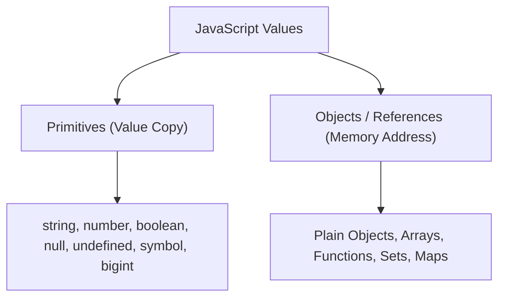
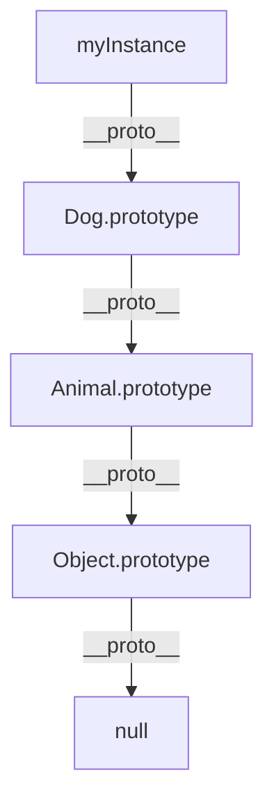
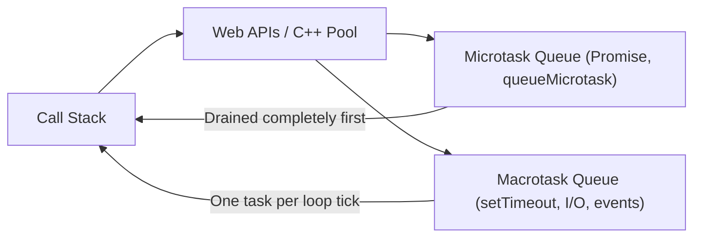

# 📘 The Complete Modern JavaScript Mastery Tutorial (ES6 – ES2024+)

A code-first, deep-dive tutorial synthesized from the 34 core curriculum modules in [`Notes/JavaScript/`](README.md). This comprehensive guide covers engine fundamentals, execution contexts, prototypal mechanics, asynchronous architecture, design patterns, and zero-build static type checking.

---

## 📑 Table of Contents

1. [Phase 1: Foundations & Lexical Mechanics](#phase-1-foundations--lexical-mechanics)
   * [01. IIFE, Encapsulation & The Classic Module Pattern](#01-iife-encapsulation--the-classic-module-pattern)
   * [02. Data Types, References & Coercion Rules](#02-data-types-references--coercion-rules)
   * [03. Variables (`var`, `let`, `const`) & The Temporal Dead Zone](#03-variables-var-let-const--the-temporal-dead-zone)
   * [04. Loops & Iteration Constructs](#04-loops--iteration-constructs)
   * [05. Hoisting: Variable vs Function Declarations](#05-hoisting-variable-vs-function-declarations)
2. [Phase 2: Functions, Scopes & Execution Context](#phase-2-functions-scopes--execution-context)
   * [06. Functions, Parameters & Rest Syntax](#06-functions-parameters--rest-syntax)
   * [07. Scopes, Lexical Environment & Scope Chains](#07-scopes-lexical-environment--scope-chains)
   * [08. Closures: Privacy, Memoization & State](#08-closures-privacy-memoization--state)
   * [09. Synchronous vs Asynchronous Callbacks](#09-synchronous-vs-asynchronous-callbacks)
   * [10. Higher-Order Functions & Currying](#10-higher-order-functions--currying)
   * [11. Explicit `this` Binding: `call()`, `apply()`, and `bind()`](#11-explicit-this-binding-call-apply-and-bind)
3. [Phase 3: Objects, Prototypes & Object-Oriented Programming](#phase-3-objects-prototypes--object-oriented-programming)
   * [12. Object Creation Patterns & Factories](#12-object-creation-patterns--factories)
   * [13. Property Descriptors, Getters/Setters & Introspection](#13-property-descriptors-getterssetters--introspection)
   * [14. Constructor Functions & The `new` Operator](#14-constructor-functions--the-new-operator)
   * [15. Prototypes & The Prototype Chain](#15-prototypes--the-prototype-chain)
   * [16. ES6 Classes, Inheritance & Private Fields (`#`)](#16-es6-classes-inheritance--private-fields-)
   * [17. Immutability: `preventExtensions()`, `seal()`, and `freeze()`](#17-immutability-preventextensions-seal-and-freeze)
   * [18. Static Object Methods Quick Reference](#18-static-object-methods-quick-reference)
4. [Phase 4: Arrays & Keyed Collections](#phase-4-arrays--keyed-collections)
   * [19. Array Fundamentals & Memory Model](#19-array-fundamentals--memory-model)
   * [20. Modern Array Methods: Mutating vs Non-Mutating (ES2023+)](#20-modern-array-methods-mutating-vs-non-mutating-es2023)
   * [21. Array-Like Objects & Iterables](#21-array-like-objects--iterables)
   * [22. Keyed Collections: `Map`, `Set`, `WeakMap`, and `WeakSet`](#22-keyed-collections-map-set-weakmap-and-weakset)
5. [Phase 5: Asynchronous Architecture & Iterators](#phase-5-asynchronous-architecture--iterators)
   * [23. The JavaScript Event Loop & Task Queues](#23-the-javascript-event-loop--task-queues)
   * [24. Timers, Zero-Delay, Debounce & Throttle](#24-timers-zero-delay-debounce--throttle)
   * [25. Promises & `async` / `await`](#25-promises--async--await)
   * [26. Modern Networking: `fetch()` & `AbortController`](#26-modern-networking-fetch--abortcontroller)
   * [27. Iterators & Generators (`function*`, `yield`, `for await...of`)](#27-iterators--generators-function-yield-for-awaitof)
6. [Phase 6: Modern ES2024+, Web APIs & Architecture](#phase-6-modern-es2024-web-apis--architecture)
   * [28. Modules: ES Modules (ESM) vs CommonJS (CJS)](#28-modules-es-modules-esm-vs-commonjs-cjs)
   * [29. Modern Language Features (ES2020 – ES2024)](#29-modern-language-features-es2020--es2024)
   * [30. Defensive Error Handling & Error Causes (`{ cause }`)](#30-defensive-error-handling--error-causes--cause-)
   * [31. Regular Expressions (RegExp) Mastery](#31-regular-expressions-regexp-mastery)
   * [32. Browser Storage & Essential Web APIs](#32-browser-storage--essential-web-apis)
   * [33. Zero-Build Type-Safety with JSDoc (`// @ts-check`)](#33-zero-build-type-safety-with-jsdoc--ts-check)
   * [34. Architectural Design Patterns](#34-architectural-design-patterns)

---

# Phase 1: Foundations & Lexical Mechanics

## 01. IIFE, Encapsulation & The Classic Module Pattern
*(Source: [`01.introduction.js`](01.introduction.js))*

Before ES6 introduced native modules, Immediately Invoked Function Expressions (IIFEs) were the standard mechanism to create private scopes and prevent global namespace collision.

```javascript
// Variant 1: Standard Crockford syntax
(function() {
  const privateApiKey = 'sec_991823';
  console.log('Isolated execution block');
})();

// Variant 2: Unary prefix operators (avoids automatic semicolon insertion bugs)
+function() {
  // Evaluated immediately as an expression
}();

// The Classic Module Pattern (Returning a public interface):
const CounterModule = (function() {
  let count = 0; // Completely private variable

  return {
    increment() { return ++count; },
    decrement() { return --count; },
    get value() { return count; }
  };
})();

console.log(CounterModule.increment()); // 1
console.log(CounterModule.value);       // 1
console.log(CounterModule.count);       // undefined (Protected from external tampering!)
```

---

## 02. Data Types, References & Coercion Rules
*(Source: [`02.data-types-and-coercion.js`](02.data-types-and-coercion.js))*

JavaScript types are divided into two fundamental categories:
1. **Primitives** (Passed by value, immutable): `string`, `number`, `bigint`, `boolean`, `undefined`, `symbol`, and `null`.
2. **Objects** (Passed by reference, mutable): `Object`, `Array`, `Function`, `Date`, `Map`, `Set`.



### Type Coercion & Truthiness
* **Falsy values** in JavaScript: `false`, `0`, `-0`, `0n`, `""` (empty string), `null`, `undefined`, and `NaN`.
* **Everything else is truthy**, including empty arrays `[]`, empty objects `{}`, and `"0"`.

```javascript
// Implicit coercion pitfalls:
console.log('5' + 2); // '52' (String concatenation takes precedence with +)
console.log('5' - 2); // 3    (Minus operator coerces strings to numbers)
console.log(null == undefined); // true (Abstract equality)
console.log(null === undefined); // false (Strict equality, different types)
```

---

## 03. Variables (`var`, `let`, `const`) & The Temporal Dead Zone
*(Source: [`03.variables-and-tdz.js`](03.variables-and-tdz.js))*

| Feature | `var` | `let` | `const` |
|:---|:---:|:---:|:---:|
| **Scope** | Function Scope | Block Scope (`{}`) | Block Scope (`{}`) |
| **Hoisting** | Hoisted to `undefined` | Hoisted into TDZ | Hoisted into TDZ |
| **Re-declaration** | Allowed in same scope | Forbidden (`SyntaxError`) | Forbidden (`SyntaxError`) |
| **Re-assignment** | Allowed | Allowed | Forbidden (`TypeError`) |

### The Temporal Dead Zone (TDZ)
The TDZ is the period between entering a block scope and the actual variable declaration line where the variable cannot be accessed:

```javascript
{
  // TDZ for `score` begins here
  // console.log(score); // ReferenceError: Cannot access 'score' before initialization!
  
  let score = 100; // TDZ ends here
  console.log(score); // 100
}
```

> **Important**: `const` enforces immutability of the **variable binding**, not the value itself. An object declared with `const` can still have its properties mutated. Use `Object.freeze()` to enforce value immutability.

---

## 04. Loops & Iteration Constructs
*(Source: [`04.loops-and-iteration.js`](04.loops-and-iteration.js))*

JavaScript provides multiple iteration paradigms depending on the target data structure:

```javascript
const frameworks = ['React', 'Vue', 'Svelte'];

// 1. Standard for loop (Best when index arithmetic or custom increments are needed):
for (let i = 0; i < frameworks.length; i++) {
  console.log(frameworks[i]);
}

// 2. for...of loop (Best for iterable values: Arrays, Sets, Maps, Strings, Generators):
for (const item of frameworks) {
  console.log(item);
}

// 3. for...in loop (Iterates over enumerable property KEYS, including prototype chain):
// CAUTION: Do not use for...in on arrays where order matters!
const user = { name: 'Alice', role: 'Admin' };
for (const key in user) {
  if (Object.hasOwn(user, key)) {
    console.log(`${key}: ${user[key]}`);
  }
}
```

---

## 05. Hoisting: Variable vs Function Declarations
*(Source: [`05.hoisting.js`](05.hoisting.js))*

Hoisting is the engine behavior where declarations are moved into memory during the creation phase before execution starts.

```javascript
// Function declarations are HOISTED IN FULL (can be called before definition):
greet('Alice'); // 'Hello, Alice!' (Works!)

function greet(name) {
  return `Hello, ${name}!`;
}

// Function expressions are NOT hoisted as functions:
// sayBye('Alice'); // TypeError: sayBye is not a function (if var) or ReferenceError (if let/const)

const sayBye = function(name) {
  return `Goodbye, ${name}!`;
};
```

---

# Phase 2: Functions, Scopes & Execution Context

## 06. Functions, Parameters & Rest Syntax
*(Source: [`06.functions-and-parameters.js`](06.functions-and-parameters.js))*

```javascript
// Default parameters and Rest Parameters (...args):
function computeTotal(taxRate = 0.05, ...prices) {
  const sum = prices.reduce((acc, p) => acc + p, 0);
  return sum * (1 + taxRate);
}

console.log(computeTotal(0.10, 20, 30, 50)); // 110

// Arrow Functions vs Standard Functions:
// Arrow functions do NOT have their own `this`, `arguments`, or `prototype`.
const multiplier = {
  factor: 2,
  multiply(numbers) {
    // Arrow function preserves lexical `this` from outer multiply():
    return numbers.map(n => n * this.factor);
  }
};
console.log(multiplier.multiply([1, 2, 3])); // [2, 4, 6]
```

---

## 07. Scopes, Lexical Environment & Scope Chains
*(Source: [`07.scope-and-scope-chain.js`](07.scope-and-scope-chain.js))*

JavaScript uses **Lexical Scoping**: variable resolution is determined by where functions are declared in source code, not where they are executed.

```javascript
const globalConfig = 'PROD';

function outerService() {
  const serviceId = 'SRV_101';

  function innerWorker() {
    const taskId = 'TSK_99';
    // Scope Chain resolution: innerWorker -> outerService -> Global
    console.log(`Task: ${taskId}, Service: ${serviceId}, Env: ${globalConfig}`);
  }

  innerWorker();
}
outerService();
```

---

## 08. Closures: Privacy, Memoization & State
*(Source: [`08.closures.js`](08.closures.js))*

A closure is the combination of a function bundled together with references to its surrounding lexical state. Closures give functions access to their outer scope even after the outer function has returned.

```javascript
// High-Performance Memoization Cache via Closure:
function createMemoizedFibonacci() {
  const cache = new Map();

  return function fib(n) {
    if (n <= 1) return n;
    if (cache.has(n)) return cache.get(n);

    const result = fib(n - 1) + fib(n - 2);
    cache.set(n, result);
    return result;
  };
}

const fastFib = createMemoizedFibonacci();
console.log(fastFib(40)); // Calculated instantly via cached subproblems!
```

---

## 09. Synchronous vs Asynchronous Callbacks
*(Source: [`09.callbacks.js`](09.callbacks.js))*

A callback is a function passed as an argument to another function.
* **Synchronous Callback**: Executed immediately within the outer function's execution thread (e.g. `Array.prototype.map`, `sort`).
* **Asynchronous Callback**: Deferred to a future event loop tick (e.g. `setTimeout`, DOM event listeners).

---

## 10. Higher-Order Functions & Currying
*(Source: [`10.higher-order-functions.js`](10.higher-order-functions.js))*

A Higher-Order Function (HOF) is a function that takes one or more functions as arguments, or returns a function.

```javascript
// Currying: Converting a function of N arguments into N unary functions
const multiply = a => b => a * b;

const double = multiply(2);
const triple = multiply(3);

console.log(double(10)); // 20
console.log(triple(10)); // 30

// Function Composition Pipeline:
const compose = (f, g) => x => f(g(x));
const trim = s => s.trim();
const toUpper = s => s.toUpperCase();
const formatTitle = compose(toUpper, trim);

console.log(formatTitle('   hello world   ')); // 'HELLO WORLD'
```

---

## 11. Explicit `this` Binding: `call()`, `apply()`, and `bind()`
*(Source: [`11.call-apply-bind.js`](11.call-apply-bind.js))*

`this` in standard functions is dynamic and bound at call time. JavaScript provides three methods to control it:

```javascript
function introduce(greeting, punctuation) {
  return `${greeting}, I am ${this.name}${punctuation}`;
}

const author = { name: 'Ada Lovelace' };

// 1. call(): Invokes immediately, arguments passed comma-separated:
console.log(introduce.call(author, 'Hello', '!'));

// 2. apply(): Invokes immediately, arguments passed as an array:
console.log(introduce.apply(author, ['Greetings', '.']));

// 3. bind(): Returns a NEW function with `this` permanently locked:
const boundIntroduce = introduce.bind(author, 'Welcome');
console.log(boundIntroduce('!!!')); // 'Welcome, I am Ada Lovelace!!!'
```

---

# Phase 3: Objects, Prototypes & Object-Oriented Programming

## 12. Object Creation Patterns & Factories
*(Source: [`12.object-creation.js`](12.object-creation.js))*

```javascript
// Factory Function Pattern with Object Composition:
function createUser(username, role) {
  return {
    username,
    role,
    createdAt: new Date(),
    printSummary() {
      console.log(`User: ${this.username} (${this.role})`);
    }
  };
}

const admin = createUser('ada_dev', 'admin');
admin.printSummary();
```

---

## 13. Property Descriptors, Getters/Setters & Introspection
*(Source: [`13.object-methods-and-descriptors.js`](13.object-methods-and-descriptors.js))*

Every property has metadata attributes called **descriptors**:
* `value`: The actual data.
* `writable`: Whether the value can be changed.
* `enumerable`: Whether it appears in `for...in` and `Object.keys()`.
* `configurable`: Whether the descriptor can be modified or property deleted.

```javascript
const account = {};

Object.defineProperty(account, 'accountNumber', {
  value: 'ACC-1234',
  writable: false,
  enumerable: true,
  configurable: false
});

// Accessor properties (Getters & Setters):
const wallet = {
  _balance: 100,
  get balance() { return `\$${this._balance}`; },
  set balance(amount) {
    if (amount < 0) throw new RangeError('Balance cannot be negative');
    this._balance = amount;
  }
};
```

---

## 14. Constructor Functions & The `new` Operator
*(Source: [`14.constructor-functions.js`](14.constructor-functions.js))*

When calling `new ConstructorFunction(...)`, the engine executes 4 distinct steps:
1. Creates a brand-new, empty object: `{}`.
2. Sets the prototype (`__proto__`) of this object to `ConstructorFunction.prototype`.
3. Binds `this` to the new object and executes the constructor body.
4. Returns the new object (unless the constructor explicitly returns another object).

---

## 15. Prototypes & The Prototype Chain
*(Source: [`15.prototypes-and-prototype-chain.js`](15.prototypes-and-prototype-chain.js))*

Every JavaScript object has an internal link to another object called its prototype. When looking up a property, the engine traverses this chain until it reaches `null` (`Object.prototype.__proto__`).



---

## 16. ES6 Classes, Inheritance & Private Fields (`#`)
*(Source: [`16.oop-and-classes.js`](16.oop-and-classes.js))*

ES6 classes provide syntactic sugar over prototypal inheritance, offering clean encapsulation, constructor chaining with `super()`, and true private fields.

```javascript
class BankAccount {
  // Private field (Enforced strictly at language runtime):
  #balance = 0;

  constructor(owner, initialDeposit) {
    this.owner = owner;
    this.#balance = initialDeposit;
  }

  deposit(amount) {
    if (amount <= 0) throw new RangeError('Deposit must be positive');
    this.#balance += amount;
    return this.#balance;
  }

  get balance() {
    return this.#balance;
  }
}

const account = new BankAccount('Alice', 500);
account.deposit(200);
console.log(account.balance); // 700
// console.log(account.#balance); // SyntaxError: Private field '#balance' must be declared in an enclosing class
```

---

## 17. Immutability: `preventExtensions()`, `seal()`, and `freeze()`
*(Source: [`17.object-protection-freeze-seal.js`](17.object-protection-freeze-seal.js))*

```javascript
// 1. preventExtensions(): Cannot add new properties; can update & delete existing
const extObj = { a: 1 };
Object.preventExtensions(extObj);

// 2. seal(): Cannot add or delete properties; existing properties can be updated
const sealObj = { b: 2 };
Object.seal(sealObj);

// 3. freeze(): Complete shallow immutability (cannot add, delete, or modify values)
const freezeObj = { c: 3 };
Object.freeze(freezeObj);
```

---

## 18. Static Object Methods Quick Reference
*(Source: [`18.generic-object-methods.md`](18.generic-object-methods.md))*

* `Object.keys(obj)` / `Object.values(obj)` / `Object.entries(obj)`: Extract own enumerable keys, values, or `[k, v]` tuples.
* `Object.fromEntries(iterable)`: Reconstruct an object from key-value pairs (inverse of `entries()`).
* `Object.hasOwn(obj, prop)` (ES2022): Safe replacement for `hasOwnProperty`.
* `Object.is(a, b)`: Same-value equality handling `NaN === NaN` and `+0` vs `-0`.
* `Object.groupBy(iterable, fn)` (ES2024): Groups items into a null-prototype object.

---

# Phase 4: Arrays & Keyed Collections

## 19. Array Fundamentals & Memory Model
*(Source: [`19.arrays-fundamentals.js`](19.arrays-fundamentals.js))*

Arrays in JavaScript are specialized objects with integer keys and an auto-updating `length` property. They can be dense or sparse:

```javascript
// Sparse array (has holes):
const sparse = [1, , 3];
console.log(sparse.length); // 3
console.log(sparse[1]);      // undefined (no memory allocated for index 1)
```

---

## 20. Modern Array Methods: Mutating vs Non-Mutating (ES2023+)
*(Source: [`20.array-methods-modern.js`](20.array-methods-modern.js))*

Modern frontend state management (React, Vue, Pinia, Redux) requires **immutability**. In ES2023, JavaScript introduced non-mutating counterparts for historical in-place methods:

| In-Place (Mutating) | Safe Non-Mutating (ES2023+) | What It Does |
|:---|:---|:---|
| `.sort(fn)` | `.toSorted(fn)` | Sorts array elements |
| `.reverse()` | `.toReversed()` | Reverses array elements |
| `.splice(start, count, ...items)` | `.toSpliced(start, count, ...items)` | Removes/inserts elements |
| `arr[i] = val` | `.with(i, val)` | Replaces single index |

```javascript
const scores = [34, 12, 89, 5];

// Safe, non-mutating sorting:
const sorted = scores.toSorted((a, b) => a - b);
console.log('Original intact:', scores); // [34, 12, 89, 5]
console.log('Sorted clone:', sorted);    // [5, 12, 34, 89]

// Negative index indexing via .at():
console.log('Last item:', scores.at(-1)); // 5
```

---

## 21. Array-Like Objects & Iterables
*(Source: [`21.array-like-objects.js`](21.array-like-objects.js))*

An array-like object has a `length` property and indexed elements (e.g., `arguments`, `NodeList`), but lacks array methods like `.map()` or `.filter()`.

```javascript
// Converting array-like objects to true arrays:
function demo() {
  // Method A: Array.from() (can accept a mapping function as second arg)
  const argsA = Array.from(arguments, x => x * 2);

  // Method B: Spread operator (works on iterables)
  const argsB = [...arguments];
}
```

---

## 22. Keyed Collections: `Map`, `Set`, `WeakMap`, and `WeakSet`
*(Source: [`22.collections-map-set.js`](22.collections-map-set.js))*

### Map vs Plain Object
* **Keys**: Plain objects only allow strings or symbols. `Map` allows ANY type (objects, functions, primitives).
* **Size**: `map.size` vs `Object.keys(obj).length`.
* **Iteration**: `Map` preserves exact insertion order and implements `Symbol.iterator`.

### ES2024 Native Set Composition Methods
```javascript
const frontend = new Set(['HTML', 'CSS', 'JS']);
const backend = new Set(['Node', 'JS', 'SQL']);

console.log([...frontend.union(backend)]);        // ['HTML', 'CSS', 'JS', 'Node', 'SQL']
console.log([...frontend.intersection(backend)]); // ['JS']
console.log([...frontend.difference(backend)]);   // ['HTML', 'CSS']
```

### WeakMap & WeakSet
* Holds keys **weakly**: If no other reference to the key object exists, it is automatically garbage-collected.
* Non-iterable (no `.size` or `.keys()`). Perfect for storing private metadata on DOM elements without memory leaks.

---

# Phase 5: Asynchronous Architecture & Iterators

## 23. The JavaScript Event Loop & Task Queues
*(Source: [`23.event-loop-and-asynchronous.js`](23.event-loop-and-asynchronous.js))*

JavaScript is single-threaded. Concurrency is powered by the **Event Loop**:



> **Execution Order Rule**: Microtasks always drain completely before the next Macrotask executes!

---

## 24. Timers, Zero-Delay, Debounce & Throttle
*(Source: [`24.timers-settimeout-setinterval.js`](24.timers-settimeout-setinterval.js))*

```javascript
// Debounce: Delays execution until N ms have passed since the LAST trigger:
function debounce(fn, delayMs) {
  let timer;
  return function(...args) {
    clearTimeout(timer);
    timer = setTimeout(() => fn.apply(this, args), delayMs);
  };
}

// Throttle: Guarantees execution at most once every N ms:
function throttle(fn, intervalMs) {
  let lastTime = 0;
  return function(...args) {
    const now = Date.now();
    if (now - lastTime >= intervalMs) {
      lastTime = now;
      fn.apply(this, args);
    }
  };
}
```

---

## 25. Promises & `async` / `await`
*(Source: [`25.promises-and-async-await.js`](25.promises-and-async-await.js))*

```javascript
// Promise Combinators:
// 1. Promise.all(): Fails fast if ANY promise rejects
// 2. Promise.allSettled(): Waits for ALL to resolve or reject, never fails fast
// 3. Promise.race(): Resolves or rejects as soon as the FIRST promise settles
// 4. Promise.any(): Resolves as soon as the FIRST promise FULFILLS (ignores rejections)

const results = await Promise.allSettled([
  fetch('/api/user'),
  fetch('/api/posts')
]);
```

---

## 26. Modern Networking: `fetch()` & `AbortController`
*(Source: [`26.fetch-api-and-networking.js`](26.fetch-api-and-networking.js))*

```javascript
// Cancelling a fetch request after a timeout threshold:
async function fetchWithTimeout(url, timeoutMs = 3000) {
  const controller = new AbortController();
  const timer = setTimeout(() => controller.abort(), timeoutMs);

  try {
    const response = await fetch(url, { signal: controller.signal });
    if (!response.ok) throw new Error(`HTTP Error: ${response.status}`);
    return await response.json();
  } finally {
    clearTimeout(timer);
  }
}
```

---

## 27. Iterators & Generators (`function*`, `yield`, `for await...of`)
*(Source: [`27.generators-and-iterators.js`](27.generators-and-iterators.js))*

Generators can pause execution (`yield`) and resume on demand.

```javascript
// Infinite Fibonacci Generator (Lazy computation):
function* fibonacci() {
  let prev = 0, curr = 1;
  while (true) {
    yield curr;
    [prev, curr] = [curr, prev + curr];
  }
}

const fib = fibonacci();
console.log(fib.next().value); // 1
console.log(fib.next().value); // 1
console.log(fib.next().value); // 2
console.log(fib.next().value); // 3

// Asynchronous Generators for Streaming Data:
async function* streamPaginatedData() {
  for (let page = 1; page <= 3; page++) {
    yield await fetch(`/api/items?page=${page}`).then(r => r.json());
  }
}

for await (const pageData of streamPaginatedData()) {
  console.log('Received page:', pageData);
}
```

---

# Phase 6: Modern ES2024+, Web APIs & Architecture

## 28. Modules: ES Modules (ESM) vs CommonJS (CJS)
*(Source: [`28.modules-esm-and-cjs.js`](28.modules-esm-and-cjs.js))*

* **ESM**: Static structure, parsed asynchronously before execution, supports tree-shaking, top-level `await`, and features **Live Bindings** (modifications in exporter reflect in importer).
* **CommonJS**: Evaluated dynamically and synchronously at runtime, returns shallow value snapshots.

---

## 29. Modern Language Features (ES2020 – ES2024)
*(Source: [`29.modern-es-features.js`](29.modern-es-features.js))*

```javascript
// 1. Optional Chaining (?.) & Nullish Coalescing (??):
const port = serverConfig?.network?.port ?? 3000;

// 2. Logical Assignment (??=, ||=, &&=):
options.timeout ??= 5000;

// 3. Native Deep Cloning via structuredClone():
const deepCopy = structuredClone(complexObject); // Handles Dates, Maps, Sets!

// 4. Promise.withResolvers() (ES2024):
const { promise, resolve, reject } = Promise.withResolvers();
```

---

## 30. Defensive Error Handling & Error Causes (`{ cause }`)
*(Source: [`30.error-handling-and-causes.js`](30.error-handling-and-causes.js))*

```javascript
class PaymentError extends Error {
  constructor(message, options) {
    super(message, options);
    this.name = 'PaymentError';
  }
}

try {
  processCard();
} catch (networkErr) {
  // Chain low-level error as root cause:
  throw new PaymentError('Transaction aborted', { cause: networkErr });
}
```

---

## 31. Regular Expressions (RegExp) Mastery
*(Source: [`31.regular-expressions-mastery.js`](31.regular-expressions-mastery.js))*

* **Lookaheads (`(?=...)`, `(?!...)`)**: Match if followed / not followed by pattern.
* **Lookbehinds (`(?<=...)`, `(?<!...)`)**: Match if preceded / not preceded by pattern.
* **Named Capture Groups (`(?<name>...)`)**: Extract tokens into `match.groups`.

---

## 32. Browser Storage & Essential Web APIs
*(Source: [`32.browser-storage-and-web-apis.js`](32.browser-storage-and-web-apis.js))*

* `localStorage`: 5MB synchronous string storage, persistent across browser restarts.
* `sessionStorage`: Scoped strictly to tab lifespan.
* `IndexedDB`: Asynchronous, transactional, multi-gigabyte structured object storage.
* `URL` and `URLSearchParams`: Safe, robust URL query parsing and string building.
* `Web Workers`: Multi-threaded background tasks preventing UI thread freezes.

---

## 33. Zero-Build Type-Safety with JSDoc (`// @ts-check`)
*(Source: [`33.jsdoc-and-type-checking.js`](33.jsdoc-and-type-checking.js))*

Enable full TypeScript static type checking, autocompletion, and refactoring in plain `.js` files without compiling:

```javascript
// @ts-check
/**
 * @typedef {Object} Article
 * @property {number} id
 * @property {string} title
 * @property {string[]} tags
 */

/**
 * Publishes an article.
 * @param {Article} article
 * @returns {Promise<boolean>}
 */
async function publishArticle(article) {
  return true;
}
```

---

## 34. Architectural Design Patterns
*(Source: [`34.design-patterns.js`](34.design-patterns.js))*

* **Singleton**: Ensures a class has only one instance with a global point of access.
* **Factory**: Decouples object creation from implementation details.
* **Observer / Pub-Sub**: Event-driven decoupled communication between publishers and subscribers.
* **Module & Revealing Module**: Encapsulating private state while exposing clean API surfaces.

---

## 🎯 Summary

This tutorial synthesizes all **34 standalone modules** in [`Notes/JavaScript/`](README.md). For immediate day-to-day coding lookups, consult the **[`DEVELOPER-CHEATSHEET.md`](DEVELOPER-CHEATSHEET.md)**.
