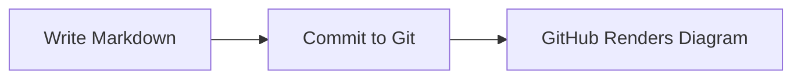
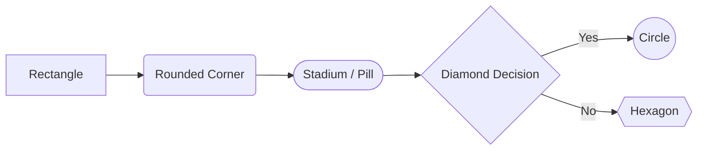
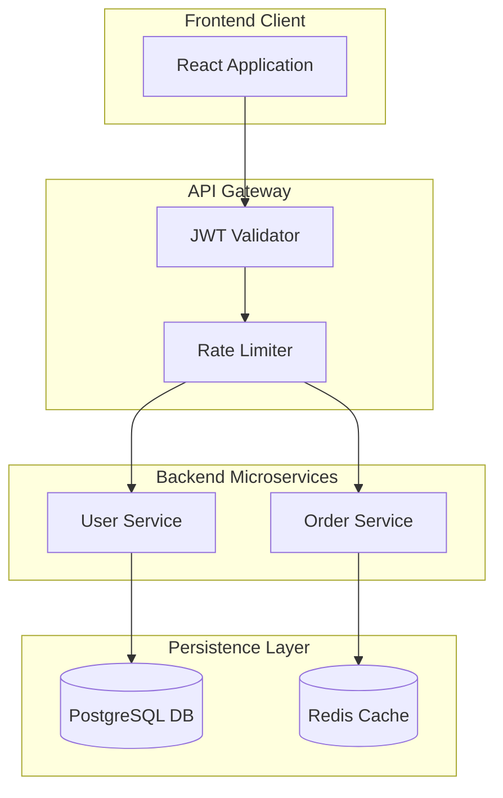
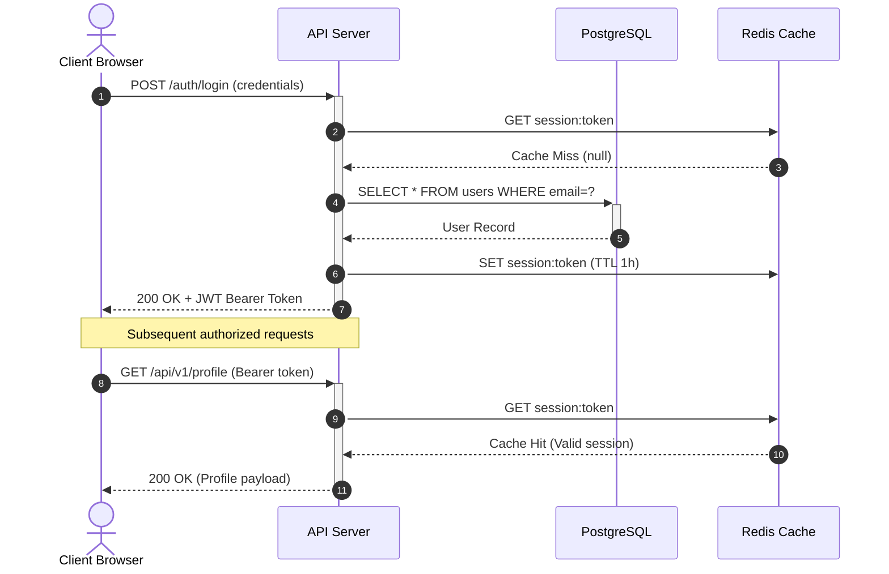
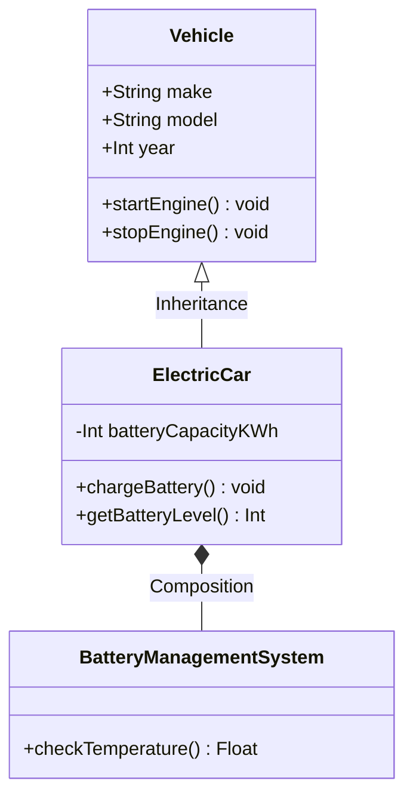
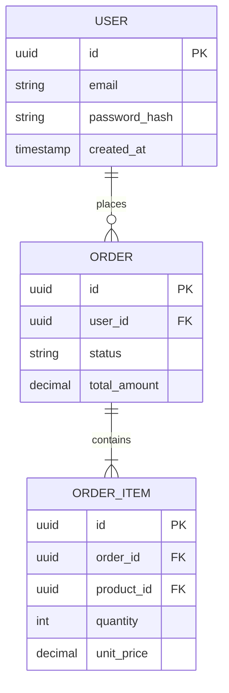
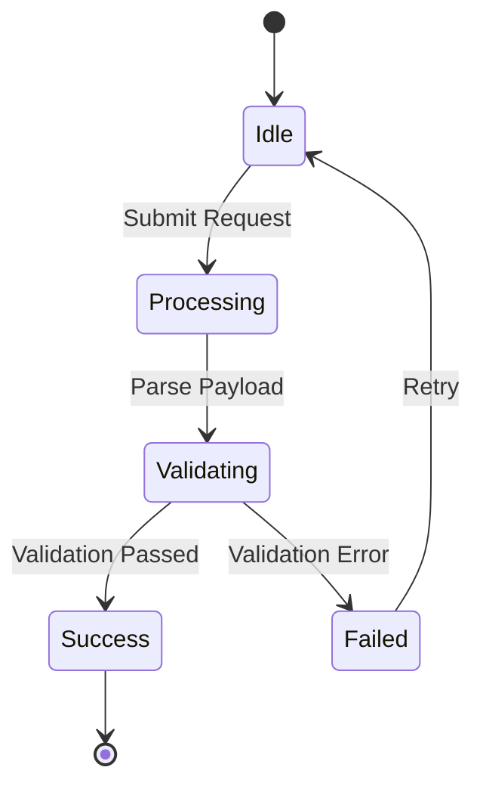
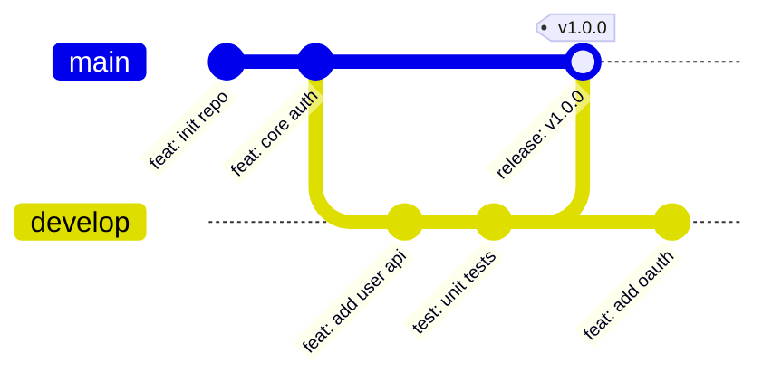
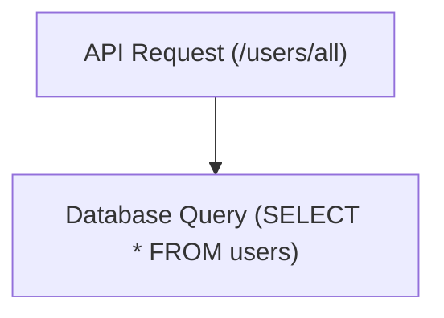

# Module 07: Diagrams with Mermaid.js

> **Scope**: Embedding interactive diagrams natively in Markdown using Mermaid.js code blocks (` ```mermaid `) across GitHub, GitLab, Obsidian, and documentation engines.

---

## 1. Introduction to Mermaid in Markdown

Mermaid allows developers to create diagrams and visualizations using text and code. GitHub natively renders fenced code blocks with the `mermaid` language tag into responsive SVG graphics without needing external image generators.

```markdown

```

---

## 2. Flowcharts (`flowchart`)

Flowcharts illustrate workflows, decision logic, and step-by-step algorithms.

### Direction Keywords
- `TD` or `TB`: Top to Bottom
- `BT`: Bottom to Top
- `LR`: Left to Right
- `RL`: Right to Left

### Node Shapes & Link Syntax



```markdown

```

### Complete Architectural Flow Example

```markdown

```

---

## 3. Sequence Diagrams (`sequenceDiagram`)

Sequence diagrams visualize process interactions over time between multiple actors or systems.

```markdown

```

### Key Notation:
- `->>` : Solid line with arrow (Synchronous request)
- `-->>` : Dashed line with arrow (Response)
- `+` / `-` : Activate / Deactivate participant execution bar
- `autonumber` : Automatically numbers each message sequence

---

## 4. Class Diagrams (`classDiagram`)

Class diagrams describe object-oriented system structures, class attributes, methods, and relationships.

```markdown

```

### Member Visibility Indicators
- `+` Public
- `-` Private
- `#` Protected
- `~` Package / Internal

---

## 5. Entity-Relationship Diagrams (`erDiagram`)

ER diagrams model relational database schemas, tables, primary/foreign keys, and cardinalities.

```markdown

```

### Cardinality Syntax
- `||--||` : Exactly one to exactly one
- `||--o{` : Exactly one to zero or more
- `||--|{` : Exactly one to one or more

---

## 6. State Diagrams (`stateDiagram-v2`)

State diagrams depict finite state machines and lifecycle changes.

```markdown

```

---

## 7. Git Graphs (`gitGraph`)

Git graphs document branching strategies, releases, merges, and cherry-picks directly in markdown.

```markdown

```

---

## 8. Common Escapes & Troubleshooting

> [!WARNING] **Special Characters Inside Node Labels**
> If a node label contains parenthesis, brackets, quotes, or colons, wrap the label in double quotes:
> - **Error**: `nodeA[function(arg)]`
> - **Fix**: `nodeA["function(arg)"]`

```markdown

```
