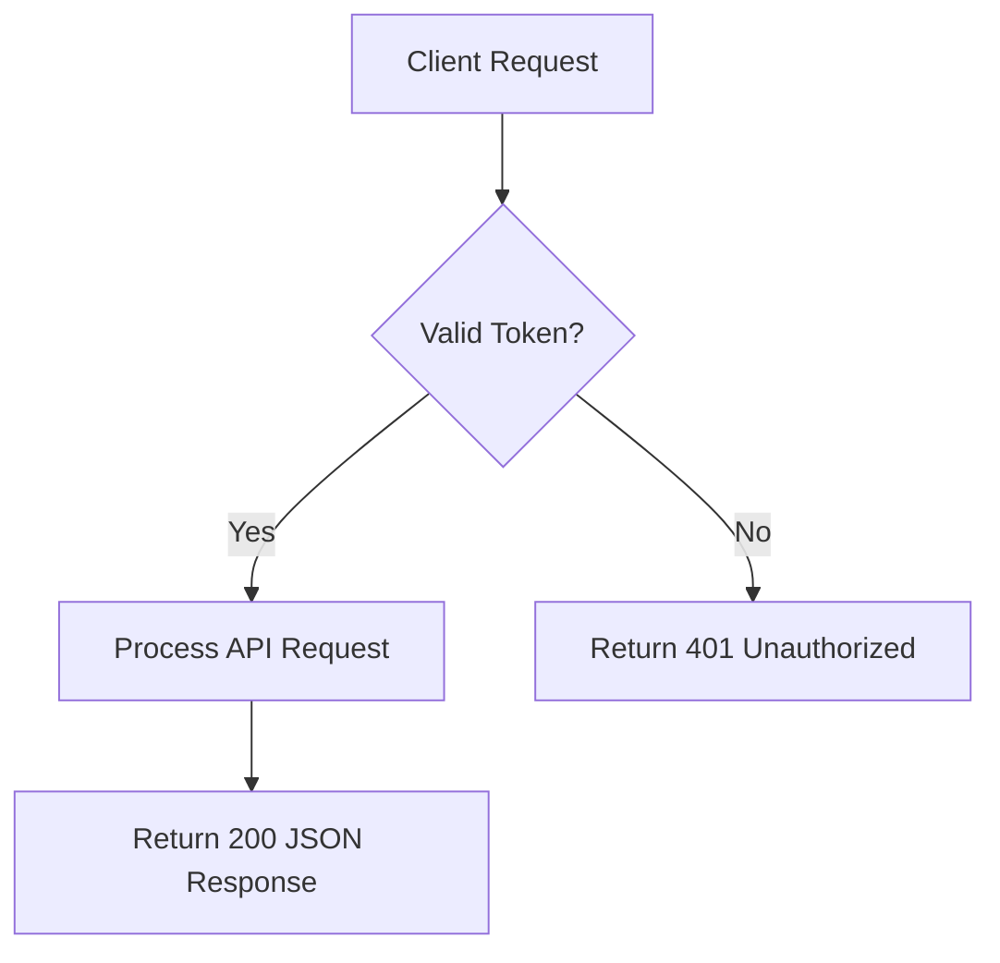

# ⚡ Complete Markdown & GFM Developer Cheatsheet

A concise, high-density desk reference for CommonMark, GitHub Flavored Markdown (GFM), and Extended Markdown syntax.

---

## 📌 Headings (ATX Style)

```markdown
# Heading 1 (Page Title / Document H1)
## Heading 2 (Major Section)
### Heading 3 (Subsection)
#### Heading 4 (Component / Topic)
##### Heading 5 (Sub-topic)
###### Heading 6 (Minor Header)
```

---

## ✍️ Text Formatting & Typography

| Style | Syntax | Rendered Result |
| :--- | :--- | :--- |
| **Bold** | `**bold text**` or `__bold text__` | **bold text** |
| *Italic* | `*italic text*` or `_italic text_` | *italic text* |
| ***Bold + Italic*** | `***bold and italic***` | ***bold and italic*** |
| ~~Strikethrough~~ | `~~strikethrough text~~` | ~~strikethrough text~~ |
| `Inline Code` | `` `const x = 42;` `` | `const x = 42;` |
| Subscript | `H~2~O` (Extended/HTML: `H<sub>2</sub>O`) | H₂O |
| Superscript | `X^2^` (Extended/HTML: `X<sup>2</sup>`) | X² |
| Keyboard Key | `<kbd>Ctrl</kbd> + <kbd>C</kbd>` | <kbd>Ctrl</kbd> + <kbd>C</kbd> |

---

## 📑 Paragraphs & Line Breaks

- **New Paragraph**: Leave one empty line between lines of text.
- **Hard Line Break**: End the line with **two trailing spaces** or a backslash `\`.
- **Horizontal Rule (Thematic Break)**: Three or more hyphens, asterisks, or underscores on their own line (`---`, `***`, `___`).

---

## 📋 Lists & Task Checklists

```markdown
<!-- Unordered List (use -, *, or +) -->
- Item A
- Item B
  - Sub-item B.1 (indented with 2 or 4 spaces)
  - Sub-item B.2

<!-- Ordered List (numbers auto-sequence) -->
1. First step
2. Second step
3. Third step

<!-- GFM Interactive Task List -->
- [x] Completed task
- [ ] Incomplete task
- [ ] \(Optional) Escaped parenthesis task
```

---

## 🔗 Links & Images

```markdown
<!-- Standard Inline Link -->
[Visit GitHub](https://github.com)

<!-- Link with Hover Title -->
[GitHub](https://github.com "GitHub Homepage")

<!-- Relative File Link (Repository navigation) -->
[Read License](../LICENSE)
[Go to line 42](src/index.js#L42-L50)

<!-- Autolink -->
<https://google.com>
contact@example.com

<!-- Inline Image -->


<!-- Clickable Image (Image wrapped in a Link) -->
[](https://github.com)
```

---

## 📊 Tables (GFM)

```markdown
| Left-Aligned Column | Centered Column | Right-Aligned Column |
| :------------------ | :-------------: | -------------------: |
| Left text           |   Center text   |               $25.00 |
| `inline code`       |  **bold text**  |              $150.00 |
| Escaped pipe \|     |     Normal      |                $5.50 |
```

---

## 💻 Code Blocks & Syntax Highlighting

````markdown
```javascript
function greet(name) {
  return `Hello, ${name}!`;
}
console.log(greet('World'));
```

```python
def calculate_total(items: list[float]) -> float:
    return sum(items)
```

```bash
# Terminal command with comments
git checkout -b feature/auth
git commit -m "feat(auth): add OAuth2 provider"
```

```diff
- const timeout = 1000;
+ const timeout = 5000;
```
````

---

## 💬 Blockquotes & GitHub Alerts

```markdown
<!-- Standard Blockquote -->
> "Simplicity is prerequisite for reliability."
> — Edsger W. Dijkstra

<!-- Nested Blockquote -->
> Outer quote level 1
>> Nested quote level 2

<!-- Modern GitHub Callout Alerts -->
> [!NOTE]
> Useful information that users should notice.

> [!TIP]
> Helpful advice for doing things better or more easily.

> [!IMPORTANT]
> Key information users need to know to achieve their goal.

> [!WARNING]
> Urgent info that needs user attention to avoid problems.

> [!CAUTION]
> Advises about risks or negative outcomes of certain actions.
```

---

## 📂 Collapsible Sections (`<details>`)

```markdown
<details>
<summary>▶ Click to inspect configuration JSON</summary>

```json
{
  "service": "auth-api",
  "port": 8080,
  "ssl": true
}
```

</details>
```

---

## 📊 Mermaid.js Diagrams

````markdown

````

---

## 🧮 LaTeX / KaTeX Mathematical Formulas

```markdown
<!-- Inline Math: Surrounded by single $ -->
The mass-energy equivalence is $E = mc^2$.

<!-- Display / Block Math: Surrounded by double $$ -->
$$
\int_{-\infty}^{\infty} e^{-x^2} dx = \sqrt{\pi}
$$
```

---

## 🛡️ HTML Entity Escaping

To display literal Markdown formatting characters without triggering parsing:
```markdown
\*literal asterisks\*
\_literal underscores\_
\# Not a header
\[Not a link\]
\`literal backtick\`
```
