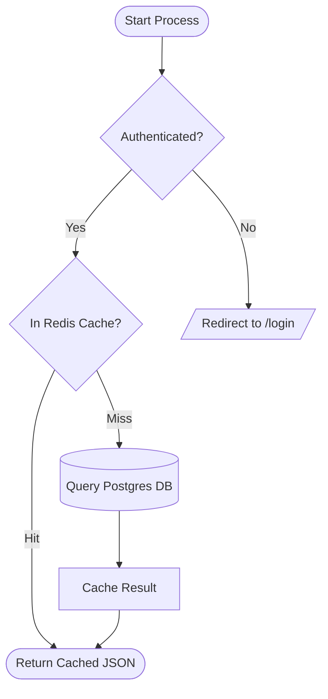
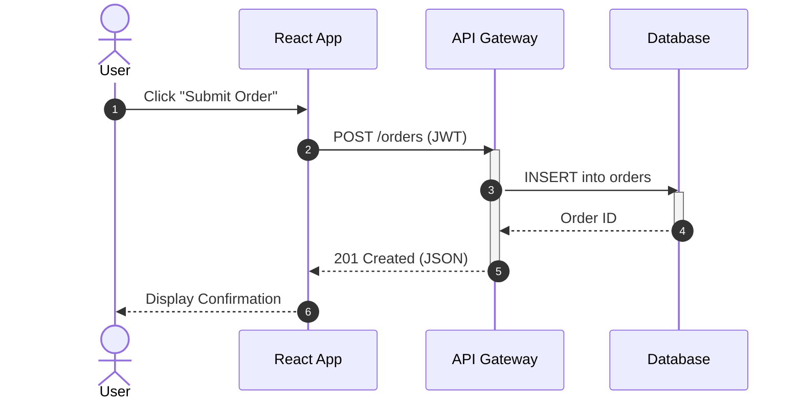
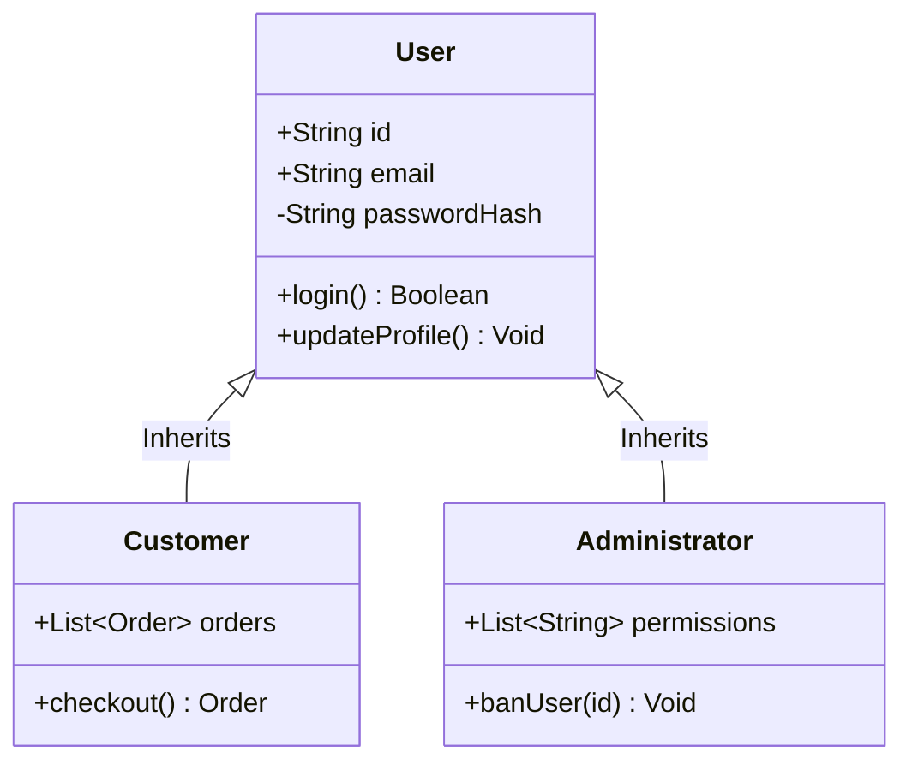
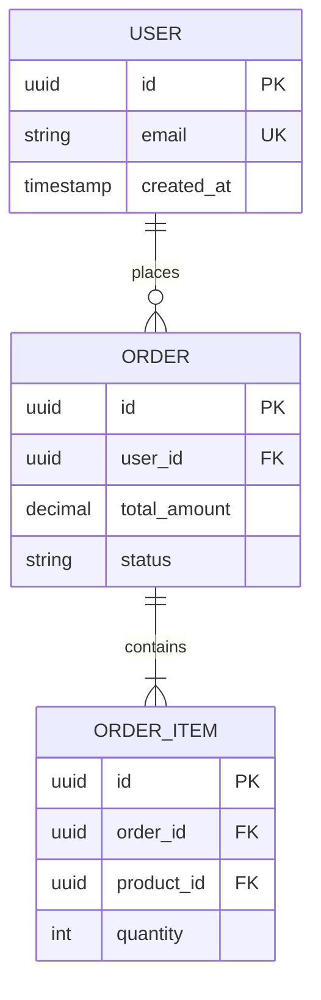
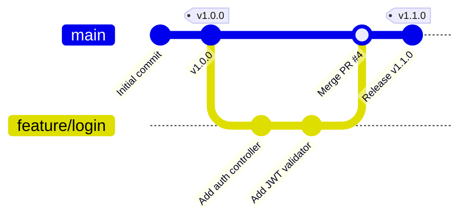
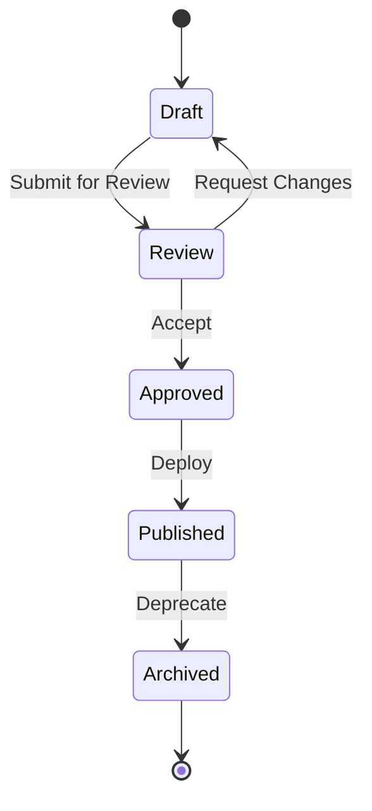

# 🎨 Extended Markdown: Mermaid, LaTeX Math & Metadata

A comprehensive guide to modern Markdown extensions: interactive Mermaid diagrams, KaTeX mathematical typography, static site generator frontmatter, and typography features.

---

## 📑 Table of Contents
1. [Mermaid.js Diagrams](#mermaidjs-diagrams)
   - [Flowcharts](#1-flowcharts)
   - [Sequence Diagrams](#2-sequence-diagrams)
   - [Class Diagrams](#3-class-diagrams)
   - [Entity-Relationship (ER) Diagrams](#4-entity-relationship-er-diagrams)
   - [Git Graphs](#5-git-graphs)
   - [State Diagrams](#6-state-diagrams)
2. [Mathematical Equations (LaTeX / KaTeX)](#mathematical-equations-latex--katex)
   - [Inline vs Display Math](#inline-vs-display-math)
   - [Fractions, Roots & Exponents](#fractions-roots--exponents)
   - [Summations, Integrals & Calculus](#summations-integrals--calculus)
   - [Matrices & Vectors](#matrices--vectors)
3. [Frontmatter Metadata (YAML / TOML)](#frontmatter-metadata-yaml--toml)
4. [Definition Lists](#definition-lists)
5. [Keyboard & Typography Elements](#keyboard--typography-elements)

---

## Mermaid.js Diagrams

GitHub, GitLab, Notion, Obsidian, and modern documentation frameworks render text-based diagram code directly into high-resolution SVG graphics via Mermaid.js.

### 1. Flowcharts
Fenced code block: ```` ```mermaid ```` with `flowchart TD` (Top-Down) or `flowchart LR` (Left-to-Right).

````markdown

````

**Node Shapes Matrix:**
- `[Text]`: Standard Rectangle
- `(Text)`: Rounded Rectangle
- `([Text])`: Pill / Stadium Shape
- `{Text}`: Decision Diamond
- `[(Text)]`: Database Cylinder
- `[/Text/]`: Parallelogram (Input/Output)
- `((Text))`: Circle

---

### 2. Sequence Diagrams
Models message exchanges between interacting services or components:

````markdown

````

---

### 3. Class Diagrams
Models Object-Oriented software architectures:

````markdown

````

---

### 4. Entity-Relationship (ER) Diagrams
Models relational database schemas:

````markdown

````

---

### 5. Git Graphs
Visualizes branch merging, rebasing, and tagging workflows:

````markdown

````

---

### 6. State Diagrams
Visualizes finite state machines (FSM):

````markdown

````

---

## Mathematical Equations (LaTeX / KaTeX)

GitHub and markdown processors support LaTeX mathematical notation parsed via KaTeX or MathJax.

### Inline vs Display Math
- **Inline Math**: Wrapped in single dollar signs `$E = mc^2$` placed inside prose.
- **Display Math**: Wrapped in double dollar signs `$$...$$` placed on its own line for centered display.

```markdown
The quadratic formula solves $ax^2 + bx + c = 0$:

$$
x = \frac{-b \pm \sqrt{b^2 - 4ac}}{2a}
$$
```

---

### Fractions, Roots & Exponents

```markdown
$$
\frac{numerator}{denominator}, \quad \sqrt[n]{x}, \quad x^{2n+1}, \quad a_{ij}
$$
```

---

### Summations, Integrals & Calculus

```markdown
$$
\sum_{i=1}^{n} i = \frac{n(n+1)}{2}
$$

$$
\int_{a}^{b} f(x) \, dx = F(b) - F(a)
$$

$$
\lim_{x \to 0} \frac{\sin x}{x} = 1
$$
```

---

### Matrices & Vectors

```markdown
$$
\mathbf{A} = \begin{pmatrix}
a_{11} & a_{12} & a_{13} \\
a_{21} & a_{22} & a_{23} \\
a_{31} & a_{32} & a_{33}
\end{pmatrix}
$$
```

---

## Frontmatter Metadata (YAML / TOML)

Static Site Generators (Jekyll, Hugo, Astro, VitePress, Gatsby) and CMS platforms parse structured metadata placed at the very beginning of a Markdown file between triple-hyphen delimiters:

```yaml
---
title: "Modern Microservices with Docker and Kubernetes"
author: "Xivig Engineering"
date: 2026-11-09
layout: post
category: DevOps
tags:
  - kubernetes
  - docker
  - architecture
draft: false
---
```

After the closing `---`, standard Markdown prose begins. The generator injects these variables into layouts, generates SEO tags, and categorizes articles.

---

## Definition Lists

Supported in Markdown Extra and Pandoc:

```markdown
CommonMark
: A robust, unambiguously defined specification for Markdown syntax created in 2014.

GFM
: GitHub Flavored Markdown, a CommonMark superset adding tables, alerts, and task lists.
```

---

## Keyboard & Typography Elements

Enhance technical documentation by rendering hardware keys and typographic entities:

```markdown
Press <kbd>Ctrl</kbd> + <kbd>Shift</kbd> + <kbd>P</kbd> to open the command palette.

Press <kbd>⌘</kbd> + <kbd>K</kbd> on macOS.
```
