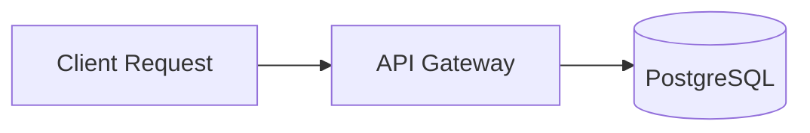

# Markdown & GitHub Flavored Markdown (GFM) Complete Master Curriculum

> **A professional, code-first reference guide and curriculum covering Standard CommonMark, GitHub Flavored Markdown (GFM), Mermaid diagrams, LaTeX mathematical expressions, Frontmatter schemas, and security pipelines.**

---

## 📚 Curriculum Navigation

This curriculum is structured into core references, specifications, and 10 progressive deep-dive modules:

### 🚀 Core Reference & Specifications
- ⚡ **[CHEATSHEET.md](CHEATSHEET.md)** — Instant one-page desk reference with copy-pasteable Markdown snippets.
- 📐 **[GFM-SPECIFICATION.md](GFM-SPECIFICATION.md)** — Deep-dive into GitHub Flavored Markdown extensions and edge cases.
- 🎨 **[EXTENDED-SYNTAX.md](EXTENDED-SYNTAX.md)** — Guide to Mermaid diagrams, LaTeX math, frontmatter, and footnotes.
- 🛡️ **[BEST-PRACTICES-AND-LINTING.md](BEST-PRACTICES-AND-LINTING.md)** — `markdownlint` rules, Prettier configuration, and README architecture.
- 📖 **[markdownSyntax.md](markdownSyntax.md)** — Single-page comprehensive syntax reference manual.

---

### 📖 Modular Deep-Dive Chapters

| Module | Title | Topics Covered | Link |
| :---: | :--- | :--- | :---: |
| **01** | **Basic Syntax** | Headings (`#`), paragraphs, soft vs hard line breaks, emphasis (bold, italic, strikethrough), thematic breaks | [Read Module 01](01-basic-syntax.md) |
| **02** | **Lists & Task Lists** | Ordered lists, unordered lists, loose vs tight lists, multi-level nesting, interactive task checklists | [Read Module 02](02-lists-and-tasklists.md) |
| **03** | **Links, Images & Badges** | Inline links, reference-style links, relative paths, image sizing via HTML, Shields.io badges | [Read Module 03](03-links-images-badges.md) |
| **04** | **Code & Syntax Highlighting** | Inline code spans, fenced code blocks, language identifiers, Git diffs, terminal session conventions | [Read Module 04](04-code-and-syntax-highlighting.md) |
| **05** | **Tables & Alignment** | GFM tables, column alignment (`:---`, `:---:`, `---:`), escaping pipes, line breaks in cells, HTML fallbacks | [Read Module 05](05-tables-and-alignment.md) |
| **06** | **Callouts, Alerts & Details** | GitHub Alerts (`[!NOTE]`, `[!TIP]`, `[!IMPORTANT]`, `[!WARNING]`, `[!CAUTION]`), `<details><summary>` accordions | [Read Module 06](06-callouts-alerts-details.md) |
| **07** | **Diagrams with Mermaid.js** | Flowcharts, Sequence diagrams, Class diagrams, ER diagrams, State diagrams, Git graphs | [Read Module 07](07-diagrams-mermaid.md) |
| **08** | **Math & LaTeX Typesetting** | KaTeX equations, inline `$`, display `$$`, Greek symbols, calculus, matrices, piecewise functions | [Read Module 08](08-math-and-latex.md) |
| **09** | **Frontmatter & Metadata** | YAML, TOML, and JSON frontmatter headers, SSG integration (Astro, Hugo, Next.js), Zod schemas | [Read Module 09](09-frontmatter-and-metadata.md) |
| **10** | **Security & Safe HTML** | GFM disallowed tags, XSS attack vectors (`javascript:` URIs, event handlers), DOMPurify & rehype pipelines | [Read Module 10](10-security-and-html.md) |

---

## 🌟 Quick Syntax Preview

### GitHub Alerts Callouts
```markdown
> [!NOTE]
> Essential background knowledge or system context.

> [!TIP]
> Useful productivity shortcut or optimization recommendation.

> [!IMPORTANT]
> Must-know configuration requirement or critical operational step.

> [!WARNING]
> Deprecation notice or behavior that could lead to errors.

> [!CAUTION]
> Irreversible data loss, destructive action, or security risk.
```

### Native Mermaid Diagrams
```markdown

```

### LaTeX Mathematical Equations
```markdown
$$
\int_{-\infty}^{\infty} e^{-x^2} \, dx = \sqrt{\pi}
$$
```

---

## 🛠️ Recommended Tooling & Linters

To maintain pristine documentation across your projects, integrate these industry standards:

- **Linter**: [`markdownlint-cli2`](https://github.com/DavidAnson/markdownlint-cli2) — catches inconsistent headings, broken list spacing, unescaped characters.
- **Formatter**: [`prettier`](https://prettier.io) with `--prose-wrap always` or `preserve`.
- **Pre-commit Hook**: Husky + `lint-staged` running `markdownlint` before commits.
- **Sanitizer**: `DOMPurify` or `rehype-sanitize` whenever processing user-submitted markdown.

---

*Part of the [xivig Developer Notes Collection](../README.md).*
