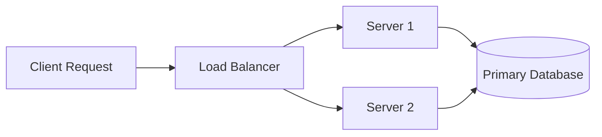

# Comprehensive Markdown & GFM Syntax Reference Guide

> **Quick Navigation**: [Cheatsheet](CHEATSHEET.md) | [Full Curriculum & Modules](README.md) | [GFM Specification](GFM-SPECIFICATION.md) | [Extended Syntax & Mermaid](EXTENDED-SYNTAX.md) | [Linting & Style](BEST-PRACTICES-AND-LINTING.md)

---

## 1. Document Structure & Headings

Markdown provides 6 levels of headings corresponding to HTML `<h1>` through `<h6>`.

```markdown
# Heading 1 (Document Title - Use Only Once)
## Heading 2 (Major Section)
### Heading 3 (Subsection)
#### Heading 4 (Deep Section)
##### Heading 5 (Minor Header)
###### Heading 6 (Sub-minor Header)
```

### Alternative Setext Headings (Level 1 & 2 only)
```markdown
Heading Level 1
===============

Heading Level 2
---------------
```

> [!TIP]
> Always prefer ATX headings (`# Heading`) with a space after the `#`. This complies with CommonMark and `markdownlint` rule `MD018`.

---

## 2. Text Formatting & Inline Styling

| Style | Syntax | Example | Output |
| :---- | :----- | :------ | :----- |
| **Bold** | `**text**` or `__text__` | `**Strong emphasis**` | **Strong emphasis** |
| *Italic* | `*text*` or `_text_` | `*Gentle emphasis*` | *Gentle emphasis* |
| ***Bold & Italic*** | `***text***` | `***Crucial point***` | ***Crucial point*** |
| ~~Strikethrough~~ | `~~text~~` | `~~Deprecated API~~` | ~~Deprecated API~~ |
| `Inline Code` | `` `code` `` | `` `const port = 8080;` `` | `const port = 8080;` |
| Subscript | `~text~` (extended) | `H~2~O` | H₂O |
| Superscript | `^text^` (extended) | `x^2^` | x² |

---

## 3. Paragraphs and Line Breaks

- **Paragraph**: Separate lines with one empty line.
- **Soft Line Break**: A single newline in raw markdown usually renders within the same paragraph on GitHub.
- **Hard Line Break**: End a line with two trailing spaces or an HTML `<br>` tag:

```markdown
First line of text with two trailing spaces  
Second line appears immediately beneath.
```

---

## 4. Lists & Checklists

### Unordered Lists
```markdown
- Item Alpha
- Item Beta
  - Sub-item Beta 1
  - Sub-item Beta 2
- Item Gamma
```

### Ordered Lists
```markdown
1. First step
2. Second step
3. Third step
   1. Sub-step 3.1
   2. Sub-step 3.2
```

### Interactive Task Lists (Checklists)
```markdown
- [x] Initial research & architectural design
- [x] Core implementation
- [ ] Comprehensive unit & integration testing
- [ ] Production deployment
```

---

## 5. Hyperlinks and References

### Inline Links
```markdown
[GitHub Documentation](https://docs.github.com)
[Download Archive](https://example.com/build.zip "Hover Tooltip Title")
```

### Reference-Style Links
```markdown
Visit the [React Documentation][react] or the [Vue Documentation][vue].

[react]: https://react.dev "React Official Site"
[vue]: https://vuejs.org "Vue Official Site"
```

### Relative Path Links
```markdown
See the [Module 05 Tables Guide](05-tables-and-alignment.md) for details.
```

---

## 6. Images and Media

### Standard Image Syntax
```markdown

```

### Linked Image (Image as a Clickable Link)
```markdown
[](https://github.com/facebook/react/actions)
```

### Explicit Sizing (HTML Fallback)
```html

```

---

## 7. Code Blocks & Syntax Highlighting

Fenced code blocks use triple backticks with an optional language identifier for syntax highlighting:

### JavaScript / TypeScript
````markdown
```typescript
interface UserProfile {
  id: string;
  name: string;
  email: string;
  isActive: boolean;
}

export function greetUser(user: UserProfile): string {
  return `Welcome, ${user.name}!`;
}
```
````

### Shell / Terminal Commands
````markdown
```bash
# Clone the repository and install dependencies
git clone https://github.com/example/project.git
cd project
npm install
npm run dev
```
````

### Git Diffs
````markdown
```diff
- const timeout = 1000;
+ const timeout = 5000; // Increased timeout for slow networks
```
````

---

## 8. Tables and Alignment

```markdown
| Method | Endpoint | Description | Auth Required |
| :----- | :------- | :---------- | :-----------: |
| `GET`  | `/api/users` | List all users | Yes |
| `POST` | `/api/login` | Authenticate credentials | No |
| `DELETE` | `/api/users/:id` | Remove user record | Yes |
```

- `:---` = Left align
- `:---:` = Center align
- `---:` = Right align
- Use `\|` to escape pipes inside cells.
- Use `<br>` for line breaks inside cells.

---

## 9. Blockquotes & GitHub Alerts

### Standard Blockquote
```markdown
> "Programs must be written for people to read, and only incidentally for machines to execute."
> — Harold Abelson
```

### GitHub Alert Callouts
```markdown
> [!NOTE]
> Information to take note of when reading.

> [!TIP]
> Useful optimization or workflow recommendation.

> [!IMPORTANT]
> Key prerequisite or necessary configuration.

> [!WARNING]
> Behavior or action that could cause errors or breakages.

> [!CAUTION]
> Irreversible data loss or severe destructive action.
```

---

## 10. Interactive Collapsible Sections

```markdown
<details>
<summary>Click here to expand technical payload details</summary>

```json
{
  "status": "success",
  "code": 200,
  "payload": {
    "userId": "usr_9981",
    "role": "admin"
  }
}
```

</details>
```

---

## 11. Mermaid Diagrams

GitHub natively parses fenced code blocks marked with `mermaid`:

````markdown

````

---

## 12. Mathematical Expressions (LaTeX / KaTeX)

### Inline Math
```markdown
The quadratic solution is given by $x = \frac{-b \pm \sqrt{b^2 - 4ac}}{2a}$.
```

### Block / Display Math
```markdown
$$
\sum_{n=1}^{\infty} \frac{1}{n^2} = \frac{\pi^2}{6}
$$
```

---

## 13. Deep-Dive Curriculum Index

For exhaustive exploration and advanced topics, refer to each specialized module:
- [Module 01: Basic Syntax](01-basic-syntax.md)
- [Module 02: Lists and Task Lists](02-lists-and-tasklists.md)
- [Module 03: Links, Images & Badges](03-links-images-badges.md)
- [Module 04: Code & Syntax Highlighting](04-code-and-syntax-highlighting.md)
- [Module 05: Tables & Alignment](05-tables-and-alignment.md)
- [Module 06: Callouts, Alerts & Details](06-callouts-alerts-details.md)
- [Module 07: Diagrams with Mermaid.js](07-diagrams-mermaid.md)
- [Module 08: Mathematical Expressions & LaTeX](08-math-and-latex.md)
- [Module 09: Frontmatter & Metadata](09-frontmatter-and-metadata.md)
- [Module 10: Security & Safe HTML](10-security-and-html.md)
- [Cheatsheet: Desk Reference](CHEATSHEET.md)
- [Best Practices & Linting](BEST-PRACTICES-AND-LINTING.md)
- [GFM Specification Guide](GFM-SPECIFICATION.md)
- [Extended Syntax Reference](EXTENDED-SYNTAX.md)
