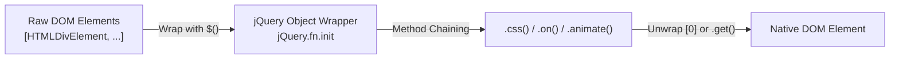
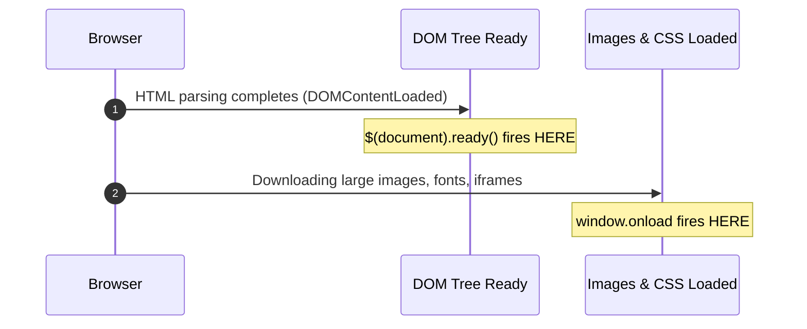
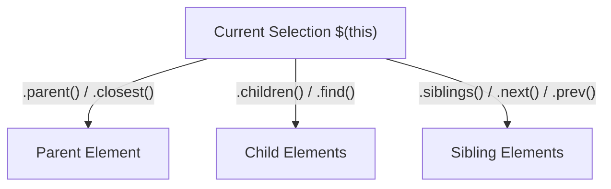
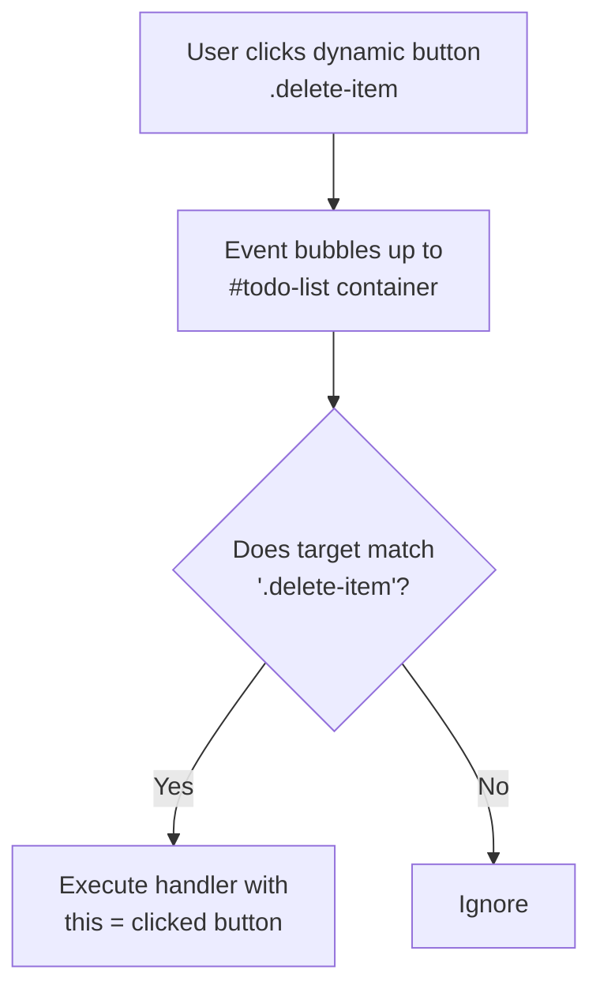

# 📘 The Complete Step-by-Step jQuery Mastery Tutorial & Reference Guide

A comprehensive, all-in-one developer manual synthesized from foundational engineering texts (*'Pro jQuery'* by Adam Freeman, *'jQuery in Action'* by Bear Bibeault, Yehuda Katz, and Aurelio De Rosa) and modern web production architectures.

---

## 📑 Table of Contents

1. [Step 1: Core Architecture & Setup](#step-1-core-architecture--setup)
   * [1.1 The Problems jQuery Solved](#11-the-problems-jquery-solved)
   * [1.2 Including jQuery (CDN, Local Fallback & NPM)](#12-including-jquery-cdn-local-fallback--npm)
   * [1.3 The jQuery Object (`$`) vs. Native DOM Elements](#13-the-jquery-object--vs-native-dom-elements)
   * [1.4 Execution Lifecycle: `$(document).ready()` vs. `window.onload`](#14-execution-lifecycle-documentready-vs-windowonload)
   * [1.5 Conflict Avoidance: `jQuery.noConflict()`](#15-conflict-avoidance-jquerynoconflict)
2. [Step 2: Complete Selector Engine & Matching](#step-2-complete-selector-engine--matching)
   * [2.1 Basic Selectors](#21-basic-selectors)
   * [2.2 Hierarchical Selectors](#22-hierarchical-selectors)
   * [2.3 Index & Positional Filters](#23-index--positional-filters)
   * [2.4 Content & Visibility Filters](#24-content--visibility-filters)
   * [2.5 Attribute Selectors](#25-attribute-selectors)
   * [2.6 Form Selectors & State Filters](#26-form-selectors--state-filters)
3. [Step 3: DOM Traversal & Selection Refinement](#step-3-dom-traversal--selection-refinement)
   * [3.1 Traversing Upward (Parents & Ancestors)](#31-traversing-upward-parents--ancestors)
   * [3.2 Traversing Downward (Children & Descendants)](#32-traversing-downward-children--descendants)
   * [3.3 Traversing Sideways (Siblings)](#33-traversing-sideways-siblings)
   * [3.4 Filtering the Collection](#34-filtering-the-collection)
   * [3.5 Selection Stack Mechanics (`.add()`, `.addBack()`, `.end()`)](#35-selection-stack-mechanics-add-addback-end)
4. [Step 4: DOM Manipulation & Content Management](#step-4-dom-manipulation--content-management)
   * [4.1 Reading & Writing Content (`.text()`, `.html()`, `.val()`)](#41-reading--writing-content-text-html-val)
   * [4.2 Attributes vs. Properties (`.attr()` vs. `.prop()`)](#42-attributes-vs-properties-attr-vs-prop)
   * [4.3 Class Manipulation & Inline Styles](#43-class-manipulation--inline-styles)
   * [4.4 Dimensions, Geometry & Scrolling](#44-dimensions-geometry--scrolling)
   * [4.5 Inserting DOM Nodes (Inside, Outside & Wrapping)](#45-inserting-dom-nodes-inside-outside--wrapping)
   * [4.6 Removing & Detaching Nodes: `.empty()` vs. `.remove()` vs. `.detach()`](#46-removing--detaching-nodes-empty-vs-remove-vs-detach)
   * [4.7 Cloning Nodes (`.clone(false)` vs. `.clone(true)`)](#47-cloning-nodes-clonefalse-vs-clonetrue)
5. [Step 5: Event Handling & Event Delegation Architecture](#step-5-event-handling--event-delegation-architecture)
   * [5.1 Modern Event Binding (`.on()` and `.off()`)](#51-modern-event-binding-on-and-off)
   * [5.2 Event Delegation: Handling Dynamic Content](#52-event-delegation-handling-dynamic-content)
   * [5.3 The Event Object Demystified](#53-the-event-object-demystified)
   * [5.4 One-Time Events (`.one()`) & Programmatic Triggering](#54-one-time-events-one--programmatic-triggering)
   * [5.5 Namespaced Events for Clean Teardowns](#55-namespaced-events-for-clean-teardowns)
6. [Step 6: Animation, Effects & Queue Management](#step-6-animation-effects--queue-management)
   * [6.1 Basic Visibility Effects (`.show()`, `.hide()`, `.toggle()`)](#61-basic-visibility-effects-show-hide-toggle)
   * [6.2 Fading & Sliding Effects](#62-fading--sliding-effects)
   * [6.3 Custom Morphing Animations (`.animate()`)](#63-custom-morphing-animations-animate)
   * [6.4 Animation Queue Control (`.stop()`, `.finish()`, `.delay()`)](#64-animation-queue-control-stop-finish-delay)
7. [Step 7: Asynchronous Networking (Ajax) & Deferreds](#step-7-asynchronous-networking-ajax--deferreds)
   * [7.1 The Core Method: `$.ajax()`](#71-the-core-method-ajax)
   * [7.2 Shorthand Helpers (`$.get()`, `$.post()`, `$.getJSON()`, `.load()`)](#72-shorthand-helpers-get-post-getjson-load)
   * [7.3 Form Serialization (`.serialize()` & `.serializeArray()`)](#73-form-serialization-serialize--serializearray)
   * [7.4 Global Ajax Lifecycle Handlers](#74-global-ajax-lifecycle-handlers)
   * [7.5 Promises & Deferreds (`$.Deferred()`, `$.when()`)](#75-promises--deferreds-deferred-when)
8. [Step 8: Advanced Utilities, Plugin Authoring & Modern Migration](#step-8-advanced-utilities-plugin-authoring--modern-migration)
   * [8.1 Core Utilities (`$.each()`, `$.extend()`, `$.grep()`, `$.map()`)](#81-core-utilities-each-extend-grep-map)
   * [8.2 Data Storage API (`.data()`) & HTML5 Datasets](#82-data-storage-api-data--html5-datasets)
   * [8.3 How to Write Professional jQuery Plugins](#83-how-to-write-professional-jquery-plugins)
   * [8.4 Performance Optimization Recipes](#84-performance-optimization-recipes)
   * [8.5 Modern Web Comparison: jQuery vs. Native Vanilla JS](#85-modern-web-comparison-jquery-vs-native-vanilla-js)

---

# Step 1: Core Architecture & Setup

## 1.1 The Problems jQuery Solved

In the 2000s and early 2010s, building web applications required navigating hostile cross-browser discrepancies:
* **Inconsistent DOM APIs**: Internet Explorer implemented `attachEvent` and `window.event`, whereas W3C standards used `addEventListener` and passed the event object into handlers.
* **Lack of Uniform CSS Selectors**: Before `document.querySelector` was standardized in browsers (2013+), retrieving elements by class or complex hierarchy required dozens of lines of nested JavaScript loops.
* **Ajax Incompatibilities**: Microsoft used `new ActiveXObject("Microsoft.XMLHTTP")` while other browsers implemented `new XMLHttpRequest()`.

jQuery solved all of this with a unified, expressive API:
$$\text{jQuery} = \text{Selector Engine (Sizzle)} + \text{DOM Wrapper Collection} + \text{Cross-Browser Normalization}$$



---

## 1.2 Including jQuery (CDN, Local Fallback & NPM)

### Production CDN with Fallback Recipe
Include jQuery from a fast public CDN (Google, Cloudflare, or jQuery official CDN) and automatically fall back to your local server if the CDN fails (e.g. offline dev or firewall blockage):

```html
<!-- Primary CDN -->
<script src="https://code.jquery.com/jquery-3.7.1.min.js" 
        integrity="sha256-/JqT3SQfawRcv/BIHPThkBvs0OEvtFFmqPF/lYI/Cxo=" 
        crossorigin="anonymous"></script>

<!-- Automated Local Fallback -->
<script>
  window.jQuery || document.write('<script src="/assets/vendor/jquery.min.js"><\/script>');
</script>
```

### Modern Bundler Installation (Vite / Webpack / ES Modules)
```bash
npm install jquery
```

```javascript
import $ from 'jquery';
// Make available globally if legacy plugins require window.$:
window.$ = window.jQuery = $;
```

---

## 1.3 The jQuery Object (`$`) vs. Native DOM Elements

A critical mental hurdle for developers is understanding that **the jQuery object is an array-like wrapper**, NOT a native DOM node.

```javascript
// Native DOM element:
const nativeElement = document.getElementById('hero-banner');
// nativeElement.css('color', 'red'); // TypeError: nativeElement.css is not a function!

// jQuery wrapped collection:
const $banner = $('#hero-banner');
$banner.css('color', 'red'); // Works!

// Converting between the two worlds:
// 1. Native -> jQuery:
const $wrapped = $(nativeElement);

// 2. jQuery -> Native:
const el1 = $banner[0];       // Direct array indexing (fastest)
const el2 = $banner.get(0);    // .get(index) method
const allNative = $banner.get(); // Returns array of all native elements: [div#hero-banner]
```

> **Naming Convention Tip**: Prefix variables that hold jQuery collections with `$` (e.g. `const $items = $('.item')`). This immediately clarifies that jQuery methods like `.addClass()` or `.find()` are available.

---

## 1.4 Execution Lifecycle: `$(document).ready()` vs. `window.onload`

Understanding execution timing prevents "Cannot read property of null" errors:



```javascript
// 1. Modern Recommended Shorthand for $(document).ready():
$(function() {
  console.log('DOM is fully constructed and interactive!');
  // Safe to query and manipulate elements here.
});

// 2. Window Load (Waits for all heavy external assets: images, fonts, iframes):
$(window).on('load', function() {
  console.log('Everything, including images and frames, is fully loaded.');
});
```

---

## 1.5 Conflict Avoidance: `jQuery.noConflict()`

Other libraries (Prototype.js, MooTools, Alpine.js) also use the `$` symbol. `jQuery.noConflict()` relinquishes control of `$`:

```javascript
// Relinquish control of $:
const jq = jQuery.noConflict();

// Use custom alias:
jq('#btn-submit').hide();

// Or isolate $ inside an IIFE (Recommended pattern):
jQuery.noConflict();
(function($) {
  // Inside this closure, $ safely refers to jQuery:
  $('.nav-item').addClass('active');
})(jQuery);
```

---

# Step 2: Complete Selector Engine & Matching

jQuery selectors allow querying the DOM using CSS1–CSS3 syntax plus extended pseudo-classes.

```
$(selector expression, [context])
```

## 2.1 Basic Selectors

| Selector | Syntax | Description | Native Equivalent |
|:---|:---|:---|:---|
| **Universal** | `$('*')` | Matches every element in the document | `document.querySelectorAll('*')` |
| **Element / Tag** | `$('p')`, `$('div')` | Matches elements by tag name | `document.getElementsByTagName('p')` |
| **ID** | `$('#main-header')` | Matches single unique element by ID | `document.getElementById('main-header')` |
| **Class** | `$('.card')` | Matches all elements with class | `document.getElementsByClassName('card')` |
| **Multiple** | `$('h1, h2, .subheading')` | Matches union of several selectors | `document.querySelectorAll('h1, h2, ...')` |

```javascript
// Selecting with context (Searches only within #sidebar):
const $linksInSidebar = $('a', '#sidebar'); 
// Equivalent to: $('#sidebar').find('a');
```

---

## 2.2 Hierarchical Selectors

```javascript
// 1. Descendant (space): Matches any descendant at any depth
$('article p'); // All <p> inside <article>

// 2. Direct Child (>): Matches immediate children only
$('ul.nav > li'); // Only <li> directly under <ul>, not nested submenus

// 3. Adjacent Sibling (+): Matches the element IMMEDIATELY following
$('h2 + p'); // First <p> directly following <h2>

// 4. General Sibling (~): Matches ALL siblings following
$('h2 ~ p'); // All <p> siblings that come after <h2>
```

---

## 2.3 Index & Positional Filters

```javascript
$('table tr:first');       // First matching row
$('table tr:last');        // Last matching row
$('table tr:even');        // Even rows (0, 2, 4...) -> 0-based index!
$('table tr:odd');         // Odd rows (1, 3, 5...)
$('table tr:eq(3)');       // Row at index 3 (4th element)
$('table tr:gt(2)');       // Rows with index greater than 2
$('table tr:lt(5)');       // Rows with index less than 5
$(':header');              // All headings: <h1> through <h6>
```

---

## 2.4 Content & Visibility Filters

```javascript
// Content Filters:
$('p:contains("JavaScript")'); // <p> containing text "JavaScript" (case-sensitive)
$('td:empty');                 // <td> that has no children (including text nodes)
$('div:has(p.alert)');         // <div> containing a <p class="alert">
$('td:parent');                // <td> that has at least one child node

// Visibility Filters:
$('div:visible');              // Takes up physical layout space in DOM
$('div:hidden');               // Matches display:none, input[type=hidden], width=0 & height=0
```

> **Note on `:hidden`**: Elements with `opacity: 0` or `visibility: hidden` are **NOT** considered `:hidden` by jQuery because they still consume physical space in the layout!

---

## 2.5 Attribute Selectors

| Selector | Meaning | Example |
|:---|:---|:---|
| `[attr]` | Has attribute | `$('input[required]')` |
| `[attr="val"]` | Exactly equal | `$('input[type="text"]')` |
| `[attr!="val"]` | Not equal to | `$('input[name!="token"]')` |
| `[attr^="val"]` | Starts with | `$('a[href^="https://"]')` (Secure links) |
| `[attr$="val"]` | Ends with | `$('a[href$=".pdf"]')` (PDF files) |
| `[attr*="val"]` | Contains substring | `$('img[src*="thumbnail"]')` |

---

## 2.6 Form Selectors & State Filters

```javascript
// Element pseudo-classes:
$(':input');     // Matches <input>, <textarea>, <select>, and <button>
$(':text');      // Matches <input type="text">
$(':checkbox');  // Matches <input type="checkbox">
$(':radio');     // Matches <input type="radio">
$(':submit');    // Matches <input type="submit"> and <button type="submit">

// State pseudo-classes:
$(':enabled');   // Elements currently enabled
$(':disabled');  // Form controls with disabled attribute
$(':checked');   // Checked checkboxes and radios
$(':selected');  // Selected <option> elements in a <select>
```

---

# Step 3: DOM Traversal & Selection Refinement

DOM Traversal moves through the DOM tree relative to a starting selection.



## 3.1 Traversing Upward (Parents & Ancestors)

```javascript
const $btn = $('.delete-btn');

$btn.parent();                // Immediate parent element
$btn.parents('div.card');     // All ancestor elements matching selector
$btn.parentsUntil('.table');  // Ancestors up to, but not including, .table

// .closest(): Climbs up tree and returns the FIRST matching ancestor (or self!)
// Crucial for event delegation:
$btn.closest('.card-row');
```

---

## 3.2 Traversing Downward (Children & Descendants)

```javascript
const $menu = $('#primary-nav');

$menu.children();            // Immediate children only (1 level deep)
$menu.children('.active');   // Immediate children matching filter

$menu.find('a.external');    // Searches ALL descendants at ANY depth
```

---

## 3.3 Traversing Sideways (Siblings)

```javascript
const $currentTab = $('.tab.active');

$currentTab.siblings();        // All other siblings
$currentTab.next();            // Immediately following sibling
$currentTab.nextAll();         // All following siblings
$currentTab.nextUntil('.sep'); // Following siblings until delimiter
$currentTab.prev();            // Immediately preceding sibling
$currentTab.prevAll();         // All preceding siblings
```

---

## 3.4 Filtering the Collection

```javascript
const $cards = $('.card');

$cards.first();                // First card in collection
$cards.last();                 // Last card in collection
$cards.eq(2);                  // Card at index 2 (3rd item)
$cards.slice(1, 4);            // Cards from index 1 up to index 4

// .filter(): Reduces collection based on selector or predicate function:
$cards.filter(function(index) {
  return $(this).data('rating') >= 4.5;
});

// .not(): Inverse of filter (removes matching items):
$cards.not('.promoted');
```

---

## 3.5 Selection Stack Mechanics (`.add()`, `.addBack()`, `.end()`)

jQuery maintains an internal stack of previous selections:

```javascript
$('ul.menu')
  .find('li')                   // Stack level 1: all <li>
    .addClass('menu-item')
    .filter('.active')          // Stack level 2: active <li> only
      .css('font-weight', 'bold')
    .end()                      // Pops stack level 2 -> returns to all <li>
    .fadeOut()
  .end();                       // Pops stack level 1 -> returns to ul.menu
```

---

# Step 4: DOM Manipulation & Content Management

## 4.1 Reading & Writing Content (`.text()`, `.html()`, `.val()`)

```javascript
// .text(): Reads or sets plain text (automatically encodes HTML entities)
const title = $('#title').text();           // Getter
$('#title').text('Secure & Safe <Escaped>'); // Setter

// .html(): Reads or sets raw inner HTML
const inner = $('#content').html();
$('#content').html('<strong>Highlighted</strong> text');

// .val(): Reads or sets form input values (text, select, radio, checkbox)
const userEmail = $('#email-input').val(); // Getter
$('#email-input').val('ada@lovelace.org');  // Setter

// Multi-select dropdown setter:
$('#skills-select').val(['JavaScript', 'TypeScript', 'CSS']);
```

---

## 4.2 Attributes vs. Properties (`.attr()` vs. `.prop()`)

> **The Golden Rule**: Use `.attr()` for HTML attributes defined in markup (initial state). Use `.prop()` for dynamic browser DOM properties (`checked`, `disabled`, `selected`, `selectedIndex`).

```javascript
const $checkbox = $('#agree-terms');

// The WRONG way (historical bug):
// $checkbox.attr('checked'); // Returns 'checked' or undefined based on initial HTML!

// The CORRECT way:
console.log($checkbox.prop('checked')); // true or false (Live boolean state!)
$checkbox.prop('checked', true);        // Checks the box
$checkbox.prop('disabled', true);       // Disables the box
```

---

## 4.3 Class Manipulation & Inline Styles

```javascript
const $card = $('#card-101');

// Class manipulation:
$card.addClass('shadow-lg border-primary');
$card.removeClass('d-none');
$card.toggleClass('expanded');
console.log($card.hasClass('shadow-lg')); // true

// Inline styles (.css):
// Getter:
const currentBg = $card.css('background-color');

// Setter (Single property):
$card.css('border-radius', '12px');

// Setter (Batch object):
$card.css({
  'background-color': '#f8f9fa',
  'padding': '1.5rem',
  'display': 'flex'
});
```

---

## 4.4 Dimensions, Geometry & Scrolling

```javascript
const $box = $('#target-box');

// 1. Box Model Dimensions:
$box.width();        // Content width
$box.innerWidth();   // Content + padding
$box.outerWidth();   // Content + padding + border
$box.outerWidth(true); // Content + padding + border + margin

// 2. Coordinate Positioning:
// .offset(): Relative to the document root (useful for floating menus & tooltips)
const { top, left } = $box.offset();

// .position(): Relative to the nearest positioned ancestor (offsetParent)
const relativePos = $box.position();

// 3. Scroll position:
const currentScroll = $(window).scrollTop();
// Smooth scroll to top:
$('html, body').animate({ scrollTop: 0 }, 600);
```

---

## 4.5 Inserting DOM Nodes (Inside, Outside & Wrapping)

```javascript
const $list = $('#task-list');

// Inside (Children):
$list.append('<li>Task: Append to end</li>');
$('<li>Task: AppendTo</li>').appendTo($list);

$list.prepend('<li>Task: Prepend to top</li>');
$('<li>Task: PrependTo</li>').prependTo($list);

// Outside (Siblings):
$list.before('<div class="header">Tasks Header</div>');
$list.after('<div class="footer">Tasks Footer</div>');

// Wrapping:
$('.badge').wrap('<div class="badge-container"></div>');
```

---

## 4.6 Removing & Detaching Nodes: `.empty()` vs. `.remove()` vs. `.detach()`

```javascript
// 1. .empty(): Wipes out all child nodes, keeps container
$('#chat-messages').empty();

// 2. .remove(): Removes elements AND permanently purges all attached event listeners and jQuery data:
$('.old-alert').remove();

// 3. .detach(): Removes elements FROM THE DOM, but KEEPS event listeners and data intact in memory!
// (Crucial for high performance when reordering or updating DOM nodes):
const $activePlayer = $('#player-card').detach();
// Perform expensive transformations off-screen...
$('#new-roster').append($activePlayer); // Handlers still work!
```

---

## 4.7 Cloning Nodes (`.clone(false)` vs. `.clone(true)`)

```javascript
// .clone(false) [default]: Copies DOM structure only
const $simpleCopy = $('#btn-action').clone();

// .clone(true): Deep copies DOM structure AND copies all attached event handlers and data!
const $interactiveCopy = $('#btn-action').clone(true);
```

---

# Step 5: Event Handling & Event Delegation Architecture

## 5.1 Modern Event Binding (`.on()` and `.off()`)

The `.on()` method is the unified standard for event handling in jQuery.

```javascript
// Basic listener:
$('#submit-btn').on('click', function(e) {
  e.preventDefault();
  console.log('Submitted!');
});

// Multiple events in single call:
$('#search-input').on({
  focus() { $(this).addClass('focused'); },
  blur()  { $(this).removeClass('focused'); },
  keyup() { console.log('Current value:', $(this).val()); }
});

// Teardown with .off():
$('#submit-btn').off('click');
```

---

## 5.2 Event Delegation: Handling Dynamic Content

When new elements are injected via Ajax or DOM operations, direct listeners bound during page load do not apply to them. **Event delegation** captures bubbling events at a stable parent ancestor:



```javascript
// BROKEN for newly added items:
// $('.delete-btn').on('click', fn); // Only binds to elements existing at startup!

// BULLETPROOF EVENT DELEGATION:
// Syntax: $(stableParent).on(eventType, childSelector, handler)
$('#todo-list').on('click', '.delete-btn', function(event) {
  event.preventDefault();
  // `this` refers to the specific .delete-btn that was clicked!
  $(this).closest('li').fadeOut(300, function() {
    $(this).remove();
  });
});
```

---

## 5.3 The Event Object Demystified

jQuery normalizes W3C and legacy IE event objects into a single consistent interface:

```javascript
$('#action-link').on('click', function(e) {
  // 1. Prevent default browser behavior (e.g. following link URL or submitting form):
  e.preventDefault();

  // 2. Stop event from bubbling up DOM tree to parent handlers:
  e.stopPropagation();

  // 3. Stop bubbling AND prevent other handlers on the SAME element from executing:
  e.stopImmediatePropagation();

  // 4. Coordinates:
  console.log('Mouse coordinates:', e.pageX, e.pageY);

  // 5. Target introspection:
  console.log('Original element clicked:', e.target);
  console.log('Element listener is bound to:', e.currentTarget); // Identical to `this`
});
```

---

## 5.4 One-Time Events (`.one()`) & Programmatic Triggering

```javascript
// .one(): Automatically unbinds after its first execution
$('#checkout-btn').one('click', function() {
  processPaymentOrder();
});

// Programmatic triggering:
// .trigger(): Fires handlers AND triggers native browser behavior
$('#search-form').trigger('submit');

// .triggerHandler(): Executes jQuery handlers ONLY; skips default browser actions and bubbling
$('#search-form').triggerHandler('submit');
```

---

## 5.5 Namespaced Events for Clean Teardowns

Namespaces allow removing specific handlers without affecting other handlers on the same element:

```javascript
// Binding with namespaces:
$(window).on('resize.userDashboard', function() { redrawCharts(); });
$(window).on('resize.navigationMenu', function() { updateNavLayout(); });

// Teardown only the dashboard listener:
$(window).off('resize.userDashboard'); // updateNavLayout remains active!
```

---

# Step 6: Animation, Effects & Queue Management

## 6.1 Basic Visibility Effects (`.show()`, `.hide()`, `.toggle()`)

```javascript
// Speeds: 'slow' (600ms), 'fast' (200ms), or milliseconds (e.g. 400)
// Complete callback executed when animation finishes:
$('#notification').hide(400, function() {
  console.log('Element is now hidden');
});

$('#notification').show('fast');
$('#notification').toggle(300); // Toggles visibility based on current state
```

---

## 6.2 Fading & Sliding Effects

```javascript
// Fading (manipulates opacity and display):
$('#modal').fadeIn(300);
$('#modal').fadeOut(300);
$('#modal').fadeToggle(300);
$('#banner').fadeTo(400, 0.5); // Fades to a specific target opacity (0.5)

// Sliding (manipulates height and overflow:hidden):
$('#faq-answer').slideDown(300);
$('#faq-answer').slideUp(300);
$('#faq-answer').slideToggle(300);
```

---

## 6.3 Custom Morphing Animations (`.animate()`)

`.animate()` interpolates numeric CSS properties over time:

```javascript
$('#rocket').animate({
  top: '-=200px',        // Relative subtraction
  left: '+=100px',       // Relative addition
  opacity: 0.8,
  width: '150px'
}, {
  duration: 800,
  easing: 'swing',       // 'swing' or 'linear'
  step(now, fx) {
    // Fired on each animation frame
  },
  complete() {
    console.log('Rocket launch animation finished!');
  }
});
```

---

## 6.4 Animation Queue Control (`.stop()`, `.finish()`, `.delay()`)

A common UI issue is **Animation Accumulation** (rapidly hovering a button triggers back-to-back animations that loop endlessly).

```javascript
// .stop(clearQueue, jumpToEnd):
// clearQueue: boolean (removes queued animations)
// jumpToEnd: boolean (instantly completes current animation)

$('.nav-item').hover(
  function() {
    $(this).find('.dropdown')
      .stop(true, true) // Halts previous animation, clears queue!
      .slideDown(200);
  },
  function() {
    $(this).find('.dropdown')
      .stop(true, true)
      .slideUp(200);
  }
);

// Delaying animations:
$('#toast').fadeIn(300).delay(3000).fadeOut(300);
```

---

# Step 7: Asynchronous Networking (Ajax) & Deferreds

## 7.1 The Core Method: `$.ajax()`

`$.ajax()` is the underlying engine for all jQuery network requests.

```javascript
$.ajax({
  url: 'https://api.xivig.org/v1/users',
  type: 'POST', // or 'method': 'POST'
  data: JSON.stringify({ name: 'Ada Lovelace', role: 'admin' }),
  contentType: 'application/json; charset=utf-8',
  dataType: 'json', // Expected server response format
  timeout: 5000,
  headers: {
    'Authorization': 'Bearer sec_token_123'
  },
  beforeSend(xhr) {
    $('#loading-spinner').show();
  }
})
.done(function(response, textStatus, jqXHR) {
  console.log('User created with ID:', response.id);
})
.fail(function(jqXHR, textStatus, errorThrown) {
  console.error('Ajax Request Failed:', textStatus, errorThrown);
})
.always(function() {
  $('#loading-spinner').hide();
});
```

---

## 7.2 Shorthand Helpers (`$.get()`, `$.post()`, `$.getJSON()`, `.load()`)

```javascript
// 1. $.get():
$.get('/api/stats', { date: '2026-11-09' }, function(data) {
  console.log('Stats:', data);
});

// 2. $.post():
$.post('/api/login', { username: 'alice', pass: 'secret' }, function(res) {
  console.log('Login status:', res.status);
});

// 3. $.getJSON(): Automatically parses JSON payload:
$.getJSON('/api/config.json', function(config) {
  console.log('Api Host:', config.host);
});

// 4. .load(): Injects server HTML directly into container (Supports fragment filtering!):
// Fetches only the #analytics-card fragment from dashboard.html:
$('#metrics-container').load('dashboard.html #analytics-card', function() {
  console.log('Analytics widget refreshed.');
});
```

---

## 7.3 Form Serialization (`.serialize()` & `.serializeArray()`)

```javascript
// URL-encoded string: "username=alice&email=alice%40example.com"
const queryString = $('#register-form').serialize();

// Array of objects: [{ name: 'username', value: 'alice' }, ...]
const formFields = $('#register-form').serializeArray();
```

---

## 7.4 Global Ajax Lifecycle Handlers

Global events allow centralizing application-wide behaviors (e.g. global loading spinners or error toasts):

```javascript
$(document).ajaxStart(function() {
  $('#global-nprogress-spinner').fadeIn();
});

$(document).ajaxStop(function() {
  $('#global-nprogress-spinner').fadeOut();
});

$(document).ajaxError(function(event, jqXHR, ajaxSettings, thrownError) {
  if (jqXHR.status === 401) {
    window.location.href = '/login.html?expired=true';
  } else if (jqXHR.status >= 500) {
    showToastAlert('Internal Server Error. Please try again later.');
  }
});
```

---

## 7.5 Promises & Deferreds (`$.Deferred()`, `$.when()`)

jQuery Deferred objects implement a Promise-like pattern:

```javascript
function loadAsyncUserData(userId) {
  const dfd = $.Deferred();

  setTimeout(function() {
    if (userId > 0) {
      dfd.resolve({ id: userId, username: 'cyber_dev' });
    } else {
      dfd.reject(new Error('Invalid User ID'));
    }
  }, 1000);

  return dfd.promise();
}

// Consuming Deferred promises:
loadAsyncUserData(42)
  .done(user => console.log('Loaded:', user.username))
  .fail(err => console.error('Error:', err.message));

// $.when() (Combinator similar to Promise.all):
$.when($.get('/api/posts'), $.get('/api/comments'))
  .done(function(postsResponse, commentsResponse) {
    console.log('Both network calls completed!');
  });
```

---

# Step 8: Advanced Utilities, Plugin Authoring & Modern Migration

## 8.1 Core Utilities (`$.each()`, `$.extend()`, `$.grep()`, `$.map()`)

```javascript
// 1. $.each(): Iterates over both Arrays and Objects
$.each(['Apple', 'Orange'], function(index, value) {
  console.log(index, value);
});

// 2. $.extend(deep, target, ...sources):
// Deep merge configuration objects:
const defaults = { server: { port: 3000, host: 'localhost' } };
const custom = { server: { port: 8080 } };
const merged = $.extend(true, {}, defaults, custom);
console.log(merged.server); // { port: 8080, host: 'localhost' }

// 3. $.grep(): Array filtering utility:
const evens = $.grep([1, 2, 3, 4, 5, 6], n => n % 2 === 0); // [2, 4, 6]

// 4. $.map(): Transforms an array:
const squares = $.map([1, 2, 3], n => n * n); // [1, 4, 9]
```

---

## 8.2 Data Storage API (`.data()`) & HTML5 Datasets

jQuery's `.data()` associates arbitrary JavaScript objects and references with DOM nodes **without memory leaks** (stored in an internal memory cache rather than direct DOM expando properties):

```html
<div id="product-card" data-product-id="1092" data-in-stock="true"></div>
```

```javascript
const $card = $('#product-card');

// Automatically parses HTML5 data-* attributes (integers, booleans, JSON):
console.log($card.data('productId')); // 1092 (Number)
console.log($card.data('inStock'));   // true (Boolean)

// Storing complex objects in memory:
$card.data('pricingMatrix', { base: 100, tiers: [0.9, 0.8] });

// Retrieving memory reference:
console.log($card.data('pricingMatrix').tiers[0]); // 0.9
```

---

## 8.3 How to Write Professional jQuery Plugins

Writing custom plugins extends `jQuery.fn` (`jQuery.prototype`). Follow this battle-tested pattern:

```javascript
(function($) {
  'use strict';

  // Plugin Definition:
  $.fn.highlightText = function(options) {
    // 1. Merge user options with sensible defaults:
    const settings = $.extend({
      color: '#ffff00',
      bold: true
    }, options);

    // 2. Maintain chainability by returning `this.each`:
    return this.each(function() {
      const $element = $(this);
      
      $element.css({
        'background-color': settings.color,
        'font-weight': settings.bold ? 'bold' : 'normal'
      });
    });
  };

})(jQuery);

// Usage:
$('p.important').highlightText({ color: '#ffeaa7' });
```

---

## 8.4 Performance Optimization Recipes

1. **Cache jQuery Selections**:
   ```javascript
   // BAD: Re-queries the entire DOM on every loop tick!
   for (let i = 0; i < 100; i++) { $('#status').text(i); }

   // GOOD: Query once, reuse reference:
   const $status = $('#status');
   for (let i = 0; i < 100; i++) { $status.text(i); }
   ```

2. **Batch DOM Insertions**:
   ```javascript
   // BAD: Triggers 1,000 DOM reflows:
   const $list = $('#items');
   for (let i = 0; i < 1000; i++) { $list.append(`<li>${i}</li>`); }

   // GOOD: Accumulate HTML string or use DocumentFragment:
   let htmlBuffer = '';
   for (let i = 0; i < 1000; i++) { htmlBuffer += `<li>${i}</li>`; }
   $list.append(htmlBuffer); // Single reflow!
   ```

3. **Use IDs or Contextual Queries**:
   * ID queries (`$('#id')`) call native `document.getElementById` and are orders of magnitude faster than loose classes (`$('.btn')`).
   * Avoid loose universal selectors (`$('*')`).

---

## 8.5 Modern Web Comparison: jQuery vs. Native Vanilla JS

For teams maintaining legacy systems or transitioning to modern vanilla JavaScript:

| Task | jQuery Syntax | Modern Native Vanilla JS |
|:---|:---|:---|
| **Query Single** | `$('#box')` | `document.querySelector('#box')` |
| **Query Multiple** | `$('.card')` | `document.querySelectorAll('.card')` |
| **Add / Remove Class** | `$el.addClass('active')` | `el.classList.add('active')` |
| **Event Listener** | `$el.on('click', fn)` | `el.addEventListener('click', fn)` |
| **Event Delegation** | `$(parent).on('click', 'li', fn)` | `parent.addEventListener('click', (e) => { const el = e.target.closest('li'); if (el) fn.call(el, e); })` |
| **Ajax / Fetch** | `$.getJSON('/api/data', fn)` | `const data = await fetch('/api/data').then(r => r.json())` |
| **DOM Creation** | `$('<div>Hello</div>')` | `const el = document.createElement('div'); el.textContent = 'Hello';` |
| **Dimensions** | `$el.outerWidth(true)` | `el.getBoundingClientRect().width` |
| **Animation** | `$el.slideUp(300)` | CSS Transitions / Web Animations API (`el.animate()`) |

---

## 📚 Companion Notes in this Directory
* [`jQueryFirst.md`](jQueryFirst.md) — Raw chapter notes and examples from *'Pro jQuery'* by Adam Freeman.
* [`jQuerySelector.md`](jQuerySelector.md) — In-depth selector specifications and edge cases from *'jQuery in Action'*.
